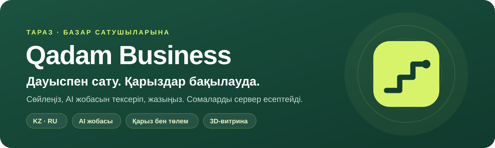
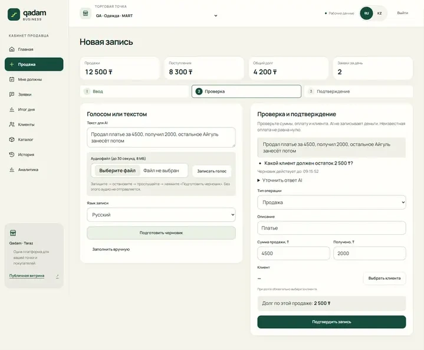
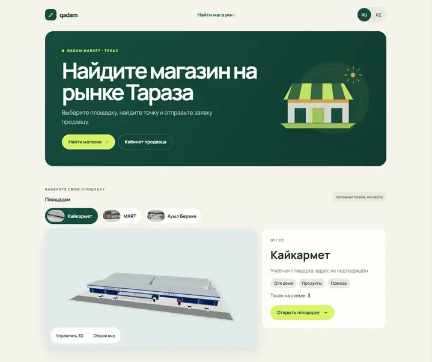
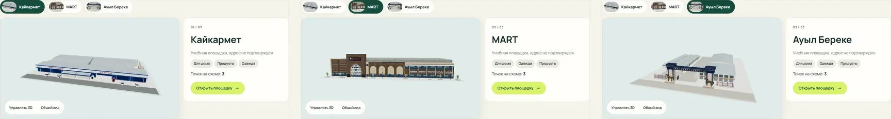
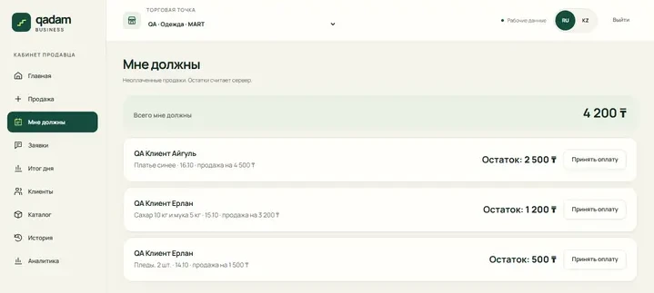

<p align="center">
  
</p>

<p align="center"><a href="README.md">Русский</a> · <b>Қазақша</b></p>

<p align="center">
  <a href="https://qadamx-taraz.pages.dev/"></a>
  <a href="https://qadamx-taraz.onrender.com/api/v1/health"></a>
  <a href="https://qadamx-taraz.onrender.com/docs"></a>
</p>

<p align="center">
  
  
  
  
  
  
  
  
</p>

**Qadam** — Тараз базарларындағы сатушыларға арналған сату, төлем және қарыз есебі, дауыспен жүргізіледі. Сатушы орысша не қазақша сөйлейді, AI жоба дайындайды, сатушы оны тексеріп, жазады. Сатып алушылар алаңдардың 3D-витринасы арқылы нүктені тауып, өтінім қалдырады.

## Қалай жұмыс істейді

<table>
  <tr>
    <td width="33%" valign="top"><b>1 · Айтыңыз</b><br><br>«Асқарға үш мың теңгеге тауар бердім, мыңын төледі»</td>
    <td width="33%" valign="top"><b>2 · Тексеріңіз</b><br><br>AI жобаны толтырады: клиент Асқар, 3 000 ₸, төленгені 1 000 ₸, қарыз 2 000 ₸</td>
    <td width="33%" valign="top"><b>3 · Жазыңыз</b><br><br>Сервер операцияны бір рет сақтап, қарыз бен күн қорытындысын қайта есептейді</td>
  </tr>
</table>

> [!IMPORTANT]
> AI тек жоба ұсынады. Сатушы растамайынша журналға ештеңе жазылмайды, ал сомалар мен қарыздарды сервер есептейді.

## Қалай көрінеді

<table>
  <tr>
    <td width="50%"><br><sub>Дауыс не мәтін → AI жобасы → тексеру</sub></td>
    <td width="50%"><br><sub>Тараз алаңдарының витринасы</sub></td>
  </tr>
  <tr>
    <td colspan="2"><br><sub>Үш алаң 3D-де: Кайкармет, MART, Ауыл Береке</sub></td>
  </tr>
  <tr>
    <td colspan="2" align="center"><br><sub>«Маған қарыз»: қалдықты сервер есептейді</sub></td>
  </tr>
</table>

## Мүмкіндіктер

| | Не | Қалай |
|:---:|---|---|
| 🎙️ | **Дауыспен не мәтінмен сату** | 30 секундқа дейін жазба, аудиофайл не мәтін. Қазақша, орысша және аралас сөйлеу |
| 🧾 | **Ішінара төлем және қарыз** | Сатылым 3 000 ₸, төленгені 1 000 ₸ → қарыз 2 000 ₸. Қосымша төлем сатылымды көбейтпейді |
| 🔒 | **Сенімді есеп** | Ақша бүтін тиынмен. Жазба атомарлы әрі идемпотентті, қайталау көшірме жасамайды. Болдырмау тарихты сақтайды |
| 👥 | **Клиенттер және тарих** | Клиентті іздеу, төленбеген сатылымдар, қате жазбаны болдырмау |
| 📊 | **Күн қорытындысы және аналитика** | Күндік, 7 және 30 күндік сатылым, түсім, қарыз және өтінімдер |
| 🏬 | **3D-витрина және өтінімдер** | Үш алаң 3D-де және кәдімгі тізіммен. Өтінім тиісті сатушыға келеді |
| ✍️ | **Қолмен енгізу** | AI қолжетімсіз болса да жұмыс істейді |
| 🐑 | **Мал базар** | Мал туралы хабарландыруларға арналған концепт және Flutter қосымшасы |

> [!NOTE]
> **Оқу деректері.** Алаңдар, нүктелер, тауарлар мен клиенттер оқу мақсатында жасалған және «Демо» деп белгіленген. MART, Кайкармет және Ауыл Береке-мен серіктестік жоқ. 3D-модельдер шартты сызба, нақты базардың жоспары емес. `/login` бетіндегі демо батырмасы кабинетті тек оқу режимінде ашады.

> [!CAUTION]
> **Әлі аяқталмағаны:**
> - iPhone және Android құрылғыларында тексеру
> - Сатушыларды тіркеу (#43)
> - Нақты сатушылармен пайдалылық сынағы

## Стек және құрылым

```text
apps/api            FastAPI, миграциялар, AI-адаптерлер, тесттер
apps/web            витрина, сатушы кабинеті, дауыстық есеп
apps/mobile         Flutter қосымшасы
packages/contracts  OpenAPI, JSON мысалдары, келісімшарттар
docs                ТТ, шешімдер, жұмысты тапсыру, есептер
```

## Жергілікті іске қосу

API (серверлік `.env` — [apps/api/README.md](apps/api/README.md) бойынша):

```bash
cd apps/api && uv sync --locked && uv run uvicorn app.main:app --host 127.0.0.1 --port 8000
```

Web (`VITE_` айнымалылары бар жария `.env.local`):

```bash
cd apps/web && npm ci && npm run dev -- --port 5173 --strictPort
```

**Тексерулер.** API: `uv run ruff check .`, `uv run python -m app.export_contracts --check`, `uv run pytest` (дерекқормен тесттер — тек бөлек PostgreSQL-де). Web: `npm run check:api`, `npm run typecheck`, `npm run lint`, `npm test`, `npm run build`, `npm run test:e2e`.

> [!WARNING]
> Production Render-де **API 0.6.3** жұмыс істейді; backup/restore тексерілгеннен кейін **0007/0008 миграциялары қолданылды**. Негізгі сайт — [Cloudflare Pages](https://qadamx-taraz.pages.dev/). [Орындалған rollout есебі](docs/PUBLIC_DATA_MARKETS_PRODUCTION_20261017.md). `health.stage=manual-ledger` — бұрынғы қызметтік белгі, AI жоқ дегенді білдірмейді және жаңа deployment талап етпейді. Жаңа жергілікті дерекқорға ағымдағы схема қажет; ортақ Supabase-те миграцияларды қайта орындамаңыз, seed пен тазалайтын тесттерді іске қоспаңыз. Құпиялар коммитке қосылмайды.

## Команда және құжаттар

<details>
<summary><b>Рөлдер және жұмысты тапсыру</b></summary>

| Рөл | Тапсырма | Жұмысты тапсыру |
|---|---|---|
| Капитан, backend | [Backend](docs/team5/03_TEAM_BACKEND.md) | [backend](docs/handoffs/backend.md) |
| Жария витрина | [Витрина және 3D](docs/team5/04_TEAM_PUBLIC_FRONTEND.md) | [public-web](docs/handoffs/public-web.md) |
| Сатушы кабинеті | [Қаңқа, кіру, өтінімдер, клиенттер](docs/team5/05_TEAM_SELLER_FRONTEND.md) | [seller-web](docs/handoffs/seller-web.md) |
| Есеп | [Дауыс, сатылым, қарыз, есептер](docs/team5/06_TEAM_LEDGER_FRONTEND.md) | [ledger-web](docs/handoffs/ledger-web.md) |
| 3D | [Алаң модельдері](docs/team5/07_TEAM_3D.md) | [assets-3d](docs/handoffs/assets-3d.md) |
| Mobile | [Flutter «Мал базар»](docs/team5/09_TEAM_MOBILE.md) | [mobile](docs/handoffs/mobile.md) |

</details>

[Өнімнің ТТ](docs/team5/00_PRODUCT_TZ.md) · [API келісімшарты](docs/team5/02_ARCHITECTURE_API.md) · [Шешімдер](docs/DECISIONS.md) · [Ағымдағы күй](docs/PROJECT_STATUS.md) · [Шығарылымдар тарихы](docs/RELEASE_HISTORY.md) · [AI нұсқаулары](AGENTS.md) · [Git ережелері](CONTRIBUTING.md)

<p align="center"><sub>Qadam командасы Таразда жасады · 2026</sub></p>
