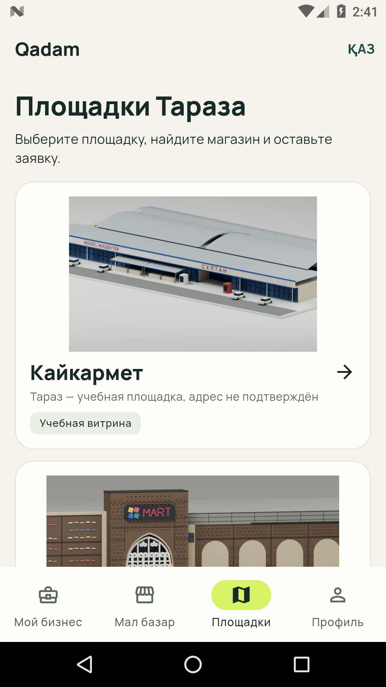

# Отказ установки Qadam 0.5.0 — открытое расследование

17 октября 2026, проверка14:41UTC. Пользователь сообщил «Не устанавливается — ошибка пакета».
Модель телефона, Android, установленная версия и точный код Package Manager пока неизвестны.
Причина не установлена; успешная проверка эмулятора не закрывает физический отказ.

## Проверенный файл

[APK0.5.0+9](https://github.com/foxfordkz-cyber/qadamx-taraz/releases/download/mobile-v0.5.0-visual.1/qadam-0.5.0-7b3a8ba-internal.apk),
source `7b3a8bad757b13e0dc37d35d703e6a53cd4d9940`,28335925bytes.
SHA256 `14f3f145ba68202611b7d0745bef8297a023fe7d23ec8bd5697688f3d9e3eccf`.
Полный файл повторно скачан с GitHub посредством HTTP Range; хеш совпал.
Первый обычный GET ранее завершился timeout, это сохранено в отчёте публикации.

APK — стандартный пакет Android, собранный Flutter/Android SDK.
BlueStacks не использовался для сборки или этой проверки. Если Windows связывает
расширение `.apk` с BlueStacks, это не меняет содержимое файла.

## Настоящий установщик Android

Изолированный официальный Android SDK эмулятор: Android7.0/API24, x86_64,
1080×1920, density420, sw411dp. Не личный телефон; тестовых аккаунтов в нём нет.
Официальный образ x86_64-24_r08.zip проверен по SHA1 из метаданных Google:
`f6559e1949a5879f31a9662f4f0e50ad60181684`.

| Действие | Результат |
|---|---|
| Установка0.4.0+8 в чистый эмулятор | SUCCESS, exit0 |
| Обновление скачанным0.5.0+9 через `adb install --no-streaming -r` | SUCCESS, exit0 |
| Запрос Package Manager после обновления | versionCode9, versionName0.5.0 |
| `am start -W` | Status:ok; MainActivity |
| Визуальная проверка после запуска | Публичные площадки отображаются |

Не применялись uninstall, очистка данных, downgrade или обход проверок установщика.
`-r` — обновление без удаления, но в чистом эмуляторе не было реальной сессии/pending:
их сохранение этим тестом не доказано. ARM-устройство, микрофон, камера, Auth A/B,
3D-жесты, деньги и прочие сценарии приёмки здесь не проверялись.

[Машиночитаемые результаты](reports/mobile-050-emulator-install.json).

## Что установил статический аудит

Package0.4/0.5 одинаковый: `kz.qadam.qadam_mobile`; minSdk24, targetSdk36,
ARM32/ARM64/x86_64. VersionCode8→9, сертификат одинаковый:
`9bd5b1febe523295d33cfb13ce1233834c5b09ae79729668067af993b245160f`.
Подписьv2/v3, ZIP CRC, zipalign16KiB и ELF LOAD>=16KiB проходят.
Бинарный manifest отличается только номером/именем версии. Общий дефект пакета
этими проверками не выявлен. Размер файла сам по себе причину отказа не определяет.

## Следующий необходимый факт

Нужны модель/Android и точный код отказа на устройстве. С разрешённой USB-отладкой
`tool/check_android_install.ps1` проверяет хеш и выполняет обновление `-r`,
фиксируя только разрешённые сведения ОС и код INSTALL_FAILED/INSTALL_PARSE_FAILED.
Не собирает токены, данные приложения или общий logcat. Сначала сверить полный
скачанный файл с SHA256 выше. Не удалять Qadam или данные для обхода отказа.

Новый APK без установленной причины не пересобирался. Source, подпись и публичные
Render/Vercel URL не менялись. PR60 остаётся Draft; production и БД не затронуты.
