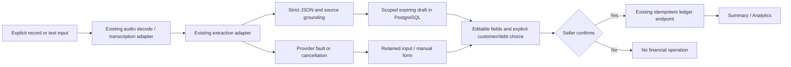
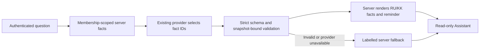

# Stage 2 — AI/Voice reliability (offline acceptance candidate)

Date: 2026-11-11. Branch: `feature/qadam-stage2-ai-voice`.
Base: **d382e80164fb2ec559db88001ba05d73fc831731**, Stage 1,
[Draft PR #104](https://github.com/foxfordkz-cyber/qadamx-taraz/pull/104).
Publication SHA/PR are recorded below; final suite results follow.
This report does not certify a real model, physical microphone or production deployment.

## Existing functionality preserved

Existing Gemini/OpenAI transports, bounded audio decoding, MediaRecorder, playback,
cancel, source text, manual entry, draft TTL/author/business checks and explicit
confirmation were retained. JWT, Membership, financial ledger, idempotency keys,
PostgreSQL migrations, public OpenAPI/generated types and frozen fixtures are unchanged.
Stage 1 supplies bounded Auth/API loading and Retry-After transport/CORS support.

## Reproduced defects and changes

Six new baseline assertions failed before changes: an unsupported 9000 total with a
3000 quote; future payment treated as received; duplicate JSON fields accepted; and
three Assistant claims with a valid number but wrong date/customer/action. All six
pass after the fix. These are deterministic regressions, not measured model accuracy.

| Problem | Change |
|---|---|
| Citation existence did not validate a monetary value | Bounded RU/KK/mixed numeric grounding checks evidence boundaries, units, decimals, words, thousands/millions and repeated expressions. Unknown/ambiguous syntax remains null. |
| Paid/debt status could overwrite an explicit partial receipt | Explicit, asserted receipt evidence takes precedence. Contradictions, future/question/negation and unsupported currency require clarification. |
| Duplicate JSON keys were silently overwritten, including before OpenAI re-encoding | Strict raw-object decoder rejects duplicates, non-finite numbers, invalid object envelopes and extra schema fields. |
| Assistant accepted a number against the wrong fact/customer and invented action claims | Existing Assistant adapters now request fact identifiers. Server validates each binding and renders RU/KK labels, amounts and reminder text from the authenticated snapshot. Arbitrary provider prose cannot become a financial answer. |
| Fallback could answer today's question with period totals or address an unrelated top debtor | Today uses today's server facts. Reminder requires an unambiguous named listed customer; otherwise seller opens debts and chooses. |
| Invalid Gemini output could trigger an automatic paid parsing retry | One extraction attempt. Explicit Retry remains a user action. Existing opt-in transport failover is unchanged and was not enabled. |
| Navigating away lost input/cooldown; returned customer suggestions were not visible | Session/business-scoped volatile input memory, preserved cooldown, explicit customer candidate buttons, validation of candidate names and reload-loss warning. |
| 429 did not distinguish a verified quota reason | Compatible AI_QUOTA_EXCEEDED remains neutral by default. Only recognized OpenAI machine codes supply RATE_LIMITED/QUOTA_EXHAUSTED metadata. No inference from HTTP 429, Gemini RESOURCE_EXHAUSTED or message text. |

Reused, reviewed helpers originated in prior repository work at
`a921b3f4d6d45a44d4529fb3045888f850cf9018`:
`assistant_structured.py`, `extraction_grounding.py`, `strict_json.py`.
Only these helpers and the corresponding Assistant integration/test adaptation were
ported; no branch merge, Research stack, database or old evaluation corpus was imported.
Stage 2 adds the regressions, context guards, error classification, frontend recovery
and new browser/PostgreSQL acceptance. This is reuse, not a newly trained AI model.

The private provider answer format changes; the public AssistantResponse does not.
An old prose-format provider answer fails closed to `source=fallback`.
The UI still distinguishes `ai`, `facts`, `fallback`, and Demo responses.
Provider docs reviewed: [OpenAI error codes](https://developers.openai.com/api/docs/guides/error-codes),
[Gemini rate limits](https://ai.google.dev/gemini-api/docs/rate-limits).
No model listing or inference API was called.

## Data flow and confirmation boundary





The grounding grammar is deliberately incomplete. It is a validation layer, not a
replacement LLM. It cannot prove a selected quote has the right semantic role in every
utterance or prove that a transcript matches actual speech. Human review is mandatory.
Unknown customer, duplicate names and repayment sale selection remain explicit choices.
No future payment becomes zero merely because receipt is unknown.

## Recovery and failure behavior

- Text, File, editable fields, draft and Retry-After survive SPA route return only in
  the current RuntimeProvider memory, keyed by session scope/business/debt route.
- Existing authenticated runtime destruction clears this memory on logout/account
  change. Restoring an expired draft is refused (draft expiry or 30-minute idle cache).
- No source text, customer, amount, audio or new token is stored in localStorage,
  sessionStorage or IndexedDB by this feature. A full reload loses the volatile input.
- The UI explains that limitation; beforeunload warns while volatile input or an
  existing unknown money POST is present. There is no public GET draft in API 0.7.2.
  Durable private recovery would require a separately designed authenticated endpoint
  and retention policy. No insecure persistent cache was introduced.
- 429/known quota, 502, 503, timeout, offline, missing configuration, invalid output
  keep manual input available; text/audio are not cleared on a failed analysis.
- No automatic retry, background replay or implicit financial confirmation.
  Unknown-result financial POST handling uses the existing exact body/key.
  Forcibly closing/reloading during an unknown money result still requires checking
  history before entering another operation; this stage does not claim exactly-once
  across lost browser memory.

## Acceptance evidence

Requested KK, RU and mixed phrases were tested using controlled provider responses.
All yield Айжан, sale 300000, received 100000 tiyn; debt is 200000.
Backend tests additionally exercise real WebM decoding for each phrase, author/business
isolation, ambiguous names, future payment, zero ledger rows before confirmation,
single-use draft and repeated confirmation with the same key.

The headed **installed Chrome** scenario performs:

1. Synthetic Supabase sign-in transport; real JWT verifier/JWKS, FastAPI and new test DB.
2. Create synthetic customer Айжан through the real UI/API.
3. KK and RU text drafts, then real WAV upload with explicit mock transcription/extraction.
4. Verify zero financial totals before confirmation; change receipt to 1100, navigate
   away/back, verify retention, correct to 1000, explicitly select Айжан.
5. Double-click confirmation; receive one sale. Repay 500; reverse that repayment;
   add fully paid sale 1200.
6. Reload summary; verify 4200 sales / 2200 receipts / 2000 debt in UI/API and SQL.
   SQL verifies **4 journal rows**, totals 420000 / 220000 / 200000 tiyn.
7. Actual PostgreSQL analytics, 30-day chart, 390px KZ without horizontal overflow;
   Assistant through real API with controlled fact-ID selection; same totals.
8. Explicit AI failure preserves source and permits manual entry.

| Evidence category | Scope |
|---|---|
| Own Physical Test | **Not Run**: no human speech captured or physical device certified. |
| Actual audio files | WAV/WebM and existing codec tests decode real containers. Generated silence/test signals, not merchant recordings. |
| Synthetic recorder E2E | Chrome generated device/permission responses. Separate from physical microphone acceptance. |
| Mock provider | All transcript, extraction and Assistant generations. Zero external AI requests, zero AI billing claims. |
| Real local services | FastAPI, JWT verification and dedicated PostgreSQL `qadam_stage2_test` on loopback port 55448. Not hosted Supabase. |
| Live Gemini/OpenAI, Android/iPhone | **Blocked/Not Run**; availability, speech accuracy and device acceptance unproven. |

Actual screenshots, reviewed to contain only synthetic data:

- [Editable audio draft](../qa/evidence/stage2-ai-voice-20261111/stage2-audio-draft-desktop.png):
  real WAV upload, **mock transcription/extraction**, no financial save yet.
- [Assistant on mobile](../qa/evidence/stage2-ai-voice-20261111/stage2-assistant-mobile.png):
  **mock provider selection**, real PostgreSQL facts. The UI's AI source label does
  not turn this offline test into live provider evidence.
- [Summary after reload](../qa/evidence/stage2-ai-voice-20261111/postgres-summary-desktop.png):
  real test ledger 4200/2200/2000.
- [KZ mobile analytics](../qa/evidence/stage2-ai-voice-20261111/postgres-analytics-kz-mobile.png):
  real test ledger; server-facts summary uses no AI.

## Commands and results

| Check | Actual result |
|---|---|
| Full backend `pytest -q`, new PostgreSQL | **463 passed, 0 skipped**, 195.20 s; one existing Starlette/httpx deprecation warning. |
| Full frontend Vitest, 48 files | **660 passed**, 253.26 s. |
| Explicit real Chrome/FastAPI/PostgreSQL acceptance | **1 passed**, 57.58 s; 4200/2200/2000 UI/API/SQL, four ledger rows. Separate from default pytest discovery. |
| Microphone browser suite | Initial **16 passed / 2 failed** (7.5 min); both failing cases passed unchanged in isolated recheck, **2/2** (37.0 s). No clean first full run claimed. |
| Assistant browser suite | **13 passed**, 1.5 min, after fixing a Windows scrollbar assumption in the test. |
| Voice integration browser suite | **1 passed**, 29.8 s; same-key unknown-result recovery, customer, payment, Analytics, reload and shop switching. |
| Auth/registration/Retry-After browser suite | **39 passed**, 3.5 min; synthetic transport with real SDK. |
| TypeScript, ESLint, production Vite build | Passed. Existing empty auth chunk and large bundle warnings remain. |
| Frontend `check:api`, backend `export_contracts --check` | Passed; no generated/public contract changes. |
| Ruff check + format | Passed; 78 Python files formatted. |
| Changed-file Prettier, `git diff --check` | Passed. |
| Full `npm run format:check` | Fails on two **unchanged baseline** files: `src/test/dashboard-demo.test.tsx`, `src/test/whatsapp-components.test.tsx`. They were not reformatted as part of AI work. |

The first frontend run had 659 pass / 1 fail: a shared mocked runtime Map retained
input between test cases. Clearing that test-owned Map in beforeEach restores isolation;
all existing assertions remain, and the full rerun passed 660/660.
The Assistant browser assertion incorrectly compared document width to the outer
viewport (345 vs 360 px with Windows vertical scrollbar). It now checks
`scrollWidth <= clientWidth`, preserving the no-horizontal-overflow requirement.
The old Voice integration test expected a pre-redesign KPI order. It now binds
each unchanged expected value to its heading rather than its card position and
opens the details panel after a shop switch. The initial run and two intermediate
test-adaptation runs failed; the final full scenario passed.
No fixture financial amounts were changed.

Microphone first-run failures were a generated-device acquisition wait and a closed
Chrome target while navigating. Both passed on recheck without product/test changes.
This is recorded as run instability, not proof of a physical microphone fix.
Local raw logs/XML/JSON remain in ignored `tmp/stage2-*` and
`apps/web/test-results/`; only reviewed synthetic screenshots are published.
No physical/live AI acceptance is claimed.

Reproduce in this branch using Node 24, Python 3.12, locked dependencies and an **empty,
dedicated** PostgreSQL database ending in `_test`, never the team's database:

```powershell
cd apps/api
uv sync --locked
# TEST_DATABASE_URL must point to your new empty test DB and differ from DATABASE_URL.
uv run pytest -q
uv run ruff check app tests migrations
uv run ruff format --check app tests migrations
uv run python -m app.export_contracts --check
uv run pytest tests/stage2_browser_acceptance.py -q -s

cd ../web
npm ci
npm run typecheck
npm run lint
npm run check:api
npm test -- --maxWorkers=1 --minWorkers=1
npm run build
$env:QADAM_STAGE2_SUITE = "microphone" # Repeat for assistant, voice, auth
npx playwright test -c e2e/stage2-chrome.playwright.config.ts
```

Browser/PostgreSQL harness starts/stops only its own API/Vite test servers (8338/4338),
uses synthetic expiring JWT files under pytest temporary storage and blocks external
browser requests. Production keys are not required. All inference is mocked.
Windows execution here used the existing matching Python venv read-only and a junction
to matching locked node_modules; no active environment dependencies were reinstalled.

## Limits and release decision

| Target | Decision |
|---|---|
| Local deterministic QA / manual finance | **GO for the tested offline scope**, with the disclosed first-run browser instability and baseline formatting warnings. Not live model acceptance. |
| Full local live AI/Voice demo | **NO-GO** until approved real provider and physical speech acceptance. |
| Hosted staging | **NO-GO**: Stage 1 dependency unmerged; Render availability was unresolved in Stage 1; no hosted Auth/DB/AI acceptance here. |
| Production | **NO-GO**: Draft review, live provider/model availability and physical devices outstanding. |

Assistant snapshots still contain the top five debtors, not every customer or transaction.
An absent person must not be described as debt-free. Named lookup outside this snapshot
requires the seller's debt list; a future authenticated lookup needs separate design.
The selector can return a valid but irrelevant fact; displayed labels expose its meaning.
No free-form provider financial prose is trusted.

Remaining follow-up: review this stacked PR after Stage 1; authorize a bounded real model
evaluation separately; confirm compatible model IDs with the owner; perform physical
RU/KZ/mixed speech tests; design private server-side draft recovery if required.
No inventory, CRM, WhatsApp automation, financial tables, real-data migration or deployment.
