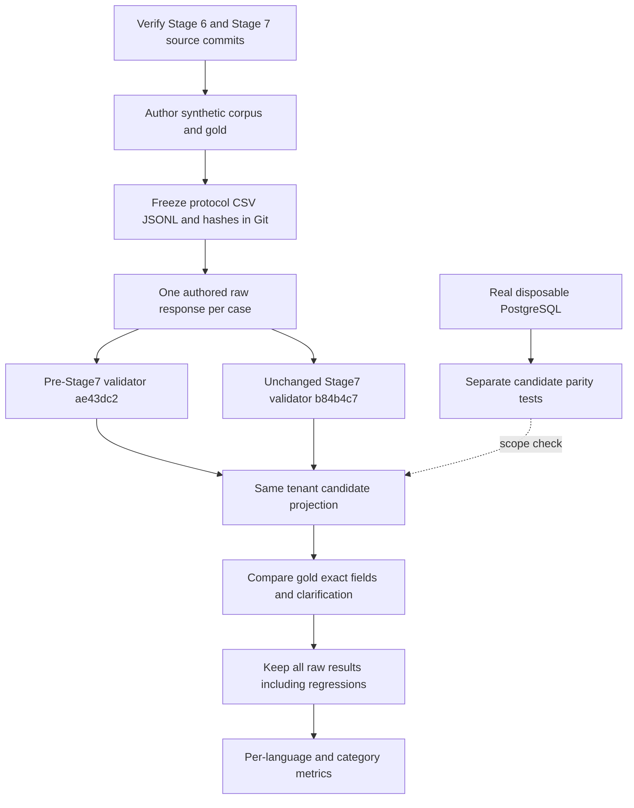
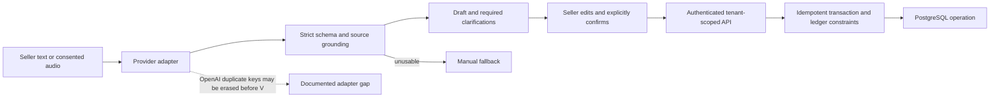
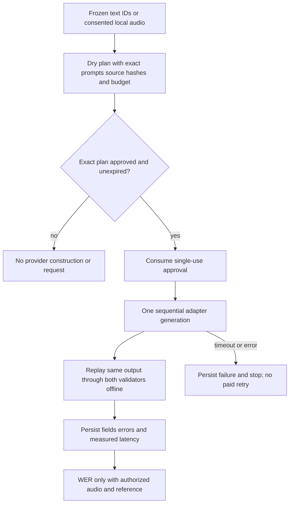

# Stage 8 extraction and evaluation flow

The runtime boxes describe existing Stage 7 behavior. Stage 8 adds the evaluation
and acceptance harnesses only.

## Frozen paired evaluation

## Actual application confirmation boundary

AI draft creation does not bypass the seller, authorization or ledger constraints.
The diagram does not claim the unresolved adapter issue is fixed.

## Optional live evaluation

No live execution occurred in Stage 8. Budget reservation is an operator guard;
it is not verified provider billing or a provider-enforced quota.
