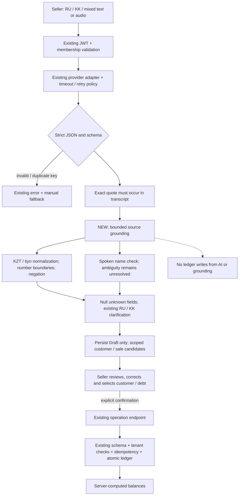

# Stage 7 extraction flow

Text is authoritative when supplied by the seller. Audio transcripts remain provider output;
this flow does not verify physical microphones or ASR. The offline evaluator replaces only
the provider response with frozen synthetic output. Browser tests keep real HTTP, signed
local test JWTs, migrations, PostgreSQL, frontend providers and explicit confirmation.
