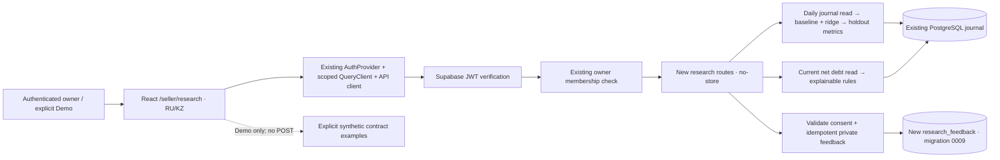
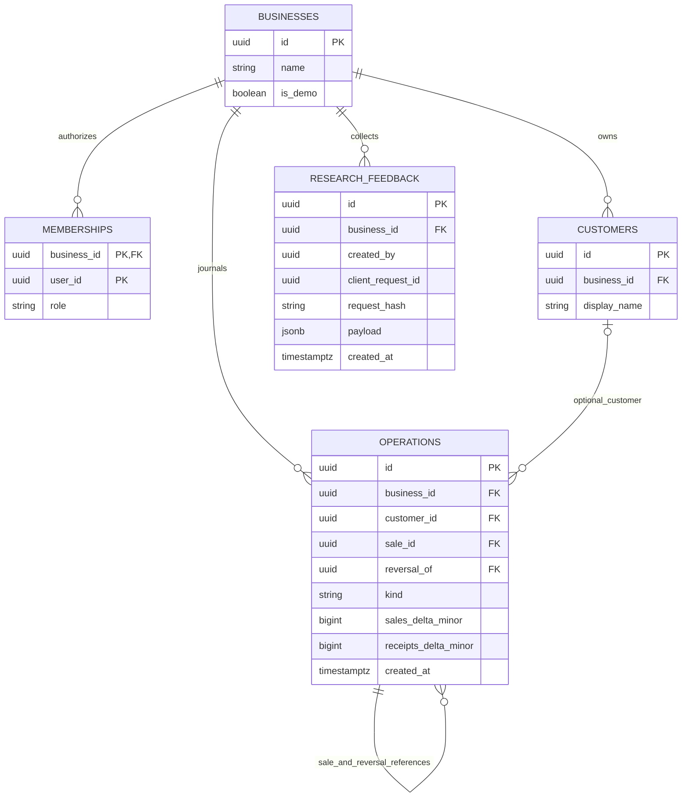

# Architecture and data flow

Scope: additive API 0.8.0 research extension on main 2518b2e; existing Auth,
ledger commands, voice, public storefront and Flutter are preserved.



The research endpoints do not call an LLM or incur paid AI requests. Forecasting
uses deterministic local numerical code with no added runtime dependency.
Business/account/epoch/horizon/page are part of query identity; scope changes remount
the page and feedback form, cancel in-flight fetches and remove old displayed data.
Live errors never fall back to Demo. Runtime validation rejects another business's
response, malformed money, invalid chronology and unexpected model/status data.

```mermaid
sequenceDiagram
  participant S as Seller
  participant W as Research screen
  participant A as FastAPI
  participant D as PostgreSQL
  S->>W: Select horizon / open research
  W->>A: GET forecast with existing Bearer session
  A->>A: Verify JWT and owner membership
  A->>D: Read one consistent daily snapshot scoped by business
  D-->>A: Completed days and as-of metadata
  A->>A: Split train / validation / test; compare and refit
  A-->>W: experimental or insufficient_data; provenance + metrics
  S->>W: Consent and explicitly submit feedback
  W->>A: POST immutable payload + client_request_id
  A->>D: Insert unique business/user/request or read same receipt
  D-->>A: Commit confirmed
  A-->>W: 201 receipt
  Note over W,A: Unknown network result retains intent; only explicit retry reuses key
```

Feedback is not a financial operation. It is readable only by the submitting
owner in the same business. Other owners cannot enumerate it. RLS and revoked
PUBLIC/anon/authenticated table grants prevent direct browser access. Administrative
research access/deletion remains an operational responsibility before recruitment.
GET and error responses are private/no-store. Neither forecast nor risk writes to
operations, customers, balances, drafts or idempotency_records.

## Database ER (research-relevant subset of actual schema)



Diagram omits unrelated tables and columns. `created_by` and `memberships.user_id`
are Supabase subjects, not new local users or foreign keys to Auth. Feedback's
unique constraint is (business_id, created_by, client_request_id); paging index is
(business_id, created_by, id). Existing journal composite foreign keys keep business,
customer, sale and reversal references consistent. No due_date or outcome column
was invented. Only research_feedback is new; migration rollback drops only that table.
