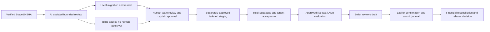

# Diploma Chapter3 evidence handoff

Topic: «Жасанды интеллект технологиялары негізінде шағын бизнестің сатылымдары мен қарыздарын басқаруға арналған ақпараттық жүйені әзірлеу»

| Defensible statement | Evidence | Boundary |
|---|---|---|
| Integrated local application uses real API/PostgreSQL |Stage10 workflow SQL/screenshots + Stage11 demo-smoke|Local JWT/offline provider; not real Supabase/AI|
| Financial journal correctness is regression-tested |Stage11 selected ledger/auth/feedback tests + Stage10 full suite|Tests are not a formal proof or production audit|
|0009 additive upgrade and restore preserve journal|migration-restore-result.json;21 checks; checksums|Small synthetic PG17.11 DB, local superuser; not managed-service/RTO test|
|7/30 forecast uses chronological evaluation|Research API source and actual local browser screenshot|179complete synthetic days; baseline selected; no merchant superiority claim|
|Debt assessment is explainable|Source and screenshot factors|Rule priority, no trained default probability/due dates|
|Strict extraction/factual grounding is evaluated offline|Frozen Stage7=99/100; Stage8–9=118/120; Stage10=42/42; Stage1 TP18/TN24|Inherited Stage10 results; constructed responses, known failures, not live model accuracy|
|Synthetic dataset limitations are quantified|dataset-audit.json:262rows,252unique,4duplicate groups|No automatic human validity; threshold0.90 near check misses semantic families|
|Independent human review is prepared|60-card blind ZIP, schema, blank A/B worksheets|0 reviewers/0annotations; no agreement or survey results|
|Release safety has actual rehearsal|Migration/restore,configuration probes,read-only browser,failed-run register|Staging and production still NO-GO|

Do not aggregate correlated/duplicated cases as independent merchant observations.
Do not sum the two Stage11 pytest runs as unique tests (6 overlap).
Do not describe Stage10 counts as freshly rerun. Preserve all failed attempts and
their resolutions; empirical provider availability, realAuth and ASR remain future work.

## Newly contributed in Stage11

- `apps/api/tools/stage11_release/`: source inventory, audit/blind-packet builder,
  new-DB-only rehearsal, config probe and read-only browser smoke.
- `apps/api/tests/test_stage11_release.py`: unsafe-input guard and packet
  reproducibility/no-gold-leakage checks.
- This14-document handoff package, raw evidence and two demo scripts; backend
  handoff/decision appendices. No ledger/Auth/AI/Research production rewrite.
- Author/tool provenance: AI-assisted engineering/review by Codex in this user's
  task. Existing team work is retained, not reassigned as this stage's contribution.

## Editable release/data flow

The sequence describes required gates, not completed deployment.
For architecture/ER/forecast diagrams, retain the existing Stage6/10 diploma evidence;
do not redraw unchanged implementation as newly built functionality.
