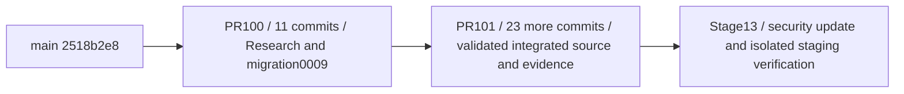

# Stacked review and future integration — no merge performed

Fresh GitHub/API and Git evidence: runs/git-before.json. Exact references:
- main: `2518b2e80b8c8ef881063a968645382d61aeb37e`.
- PR100 / feature/ml-sales-debt-research: `1ece13a1a255e301526af93bb7ac38faeba0b047`.
- PR101 / integration/qadam-diploma-v1: `55b39549bc52e767616763e0e1b5e8ab102c78e8`.
- Stage13: feature/diploma-stage13-security-staging, directly based on PR101 head.

main is an ancestor of PR100, which is an ancestor of PR101. Behind/ahead counts
are 0/11 and 0/23 respectively. Both existing PRs are open Draft, GitHub mergeable
true / clean at inspection. No new merge simulation or automatic resolution is
needed for the observed ancestor graph. Recheck after any owner change.

PR100 diff against main: 76 files, +11180/-1400. PR101 incremental diff: 599 files,
+84019/-190 (large reproducibility evidence). Overlap of those two increments is
README.md, docs/DECISIONS.md and docs/handoffs/seller-web.md. Preserve both layers,
do not choose wholesale ours/theirs. PR101 does not change OpenAPI/generated types
or migrations relative to PR100; its only packages/contracts delta is
ASSISTANT_API.md documentation. Contract version remains 0.8.0. Stage13 changes
none of these contract/migration/production source files.

Migration0009 was introduced by PR100 commit b7c4750 and follows
0008_canonical_markets. Deploying Research feedback requires it once in the
approved target. It must not be replayed against a shared DB by this task.

## Future owner-approved sequence

1. Review PR100, migration0009, privacy/retention, role boundaries and test evidence.
   Obtain integration approval. Merge preserving commit ancestry (normal merge
   commit or fast-forward if repository policy permits). Do not squash/rebase the
   base while stacked descendants depend on its hashes.
2. Keep feature/ml-sales-debt-research until PR101 is safely retargeted. With owner
   permission, retarget PR101 to updated main; verify its diff contains only the
   expected 23 commits and independent changes. Fetch and repeat contract/tests
   and conflict assessment. Do not cherry-pick PR100 again.
3. Review and integrate PR101 preserving history after explicit approval.
4. Retarget the Stage13 review to updated main only after its base lands; verify
   only the dependency fix, fixture/tools, two test configs and Stage13 evidence
   remain. Recheck the lock and relevant tests. Integrate only by owner decision.
5. If main diverges, stop; compare shared files and ask for a deliberate conflict
   resolution plan. Never force-push/rewrite descendants or silently merge them.

## Why a separate Stage13 Draft is warranted

The new security fix and runnable isolation tooling require a narrow review that
PR101 does not contain. A Draft based on integration/qadam-diploma-v1 shows ONLY
Stage13 changes, explicitly depends on PR101 and is not a competing integration
PR into main. This justification is recorded before publication. PR100/101 remain
unchanged. Publication does not authorize merge, deploy or shared migrations.
