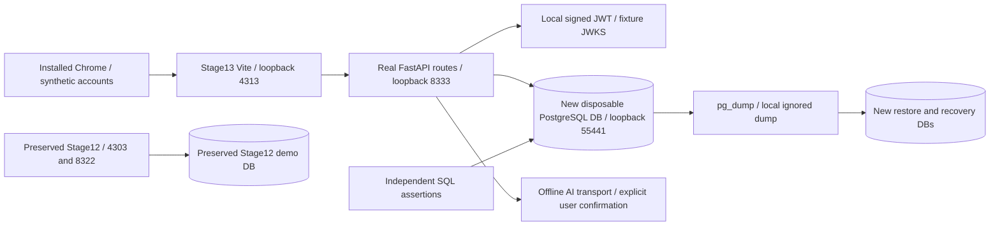
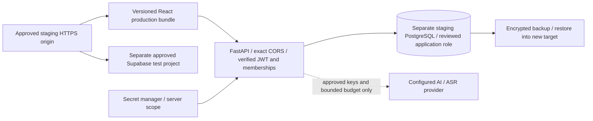

# Isolated staging architecture

Two distinct modes. The executable local rehearsal is available without a cloud
account, production secrets, customer data or paid providers. Hosted staging is a
configuration/review candidate, not a deployed or accepted service.

The second diagram is planned infrastructure; no cloud resources were created.
The local cluster is pre-existing dedicated QA PostgreSQL, with new isolated
databases for each run. It is not a separate managed server. The local owner is
elevated; managed-role/transport/RLS deployment acceptance remains separate.

Production Auth, ledger, contracts and deployment configuration are unchanged.
Never deploy tests/*_browser_server.py or expose its fixture login/JWKS routes.
Research predictions remain estimates; synthetic data do not establish merchant
accuracy. AI supplies drafts; only seller confirmation invokes the ledger.
