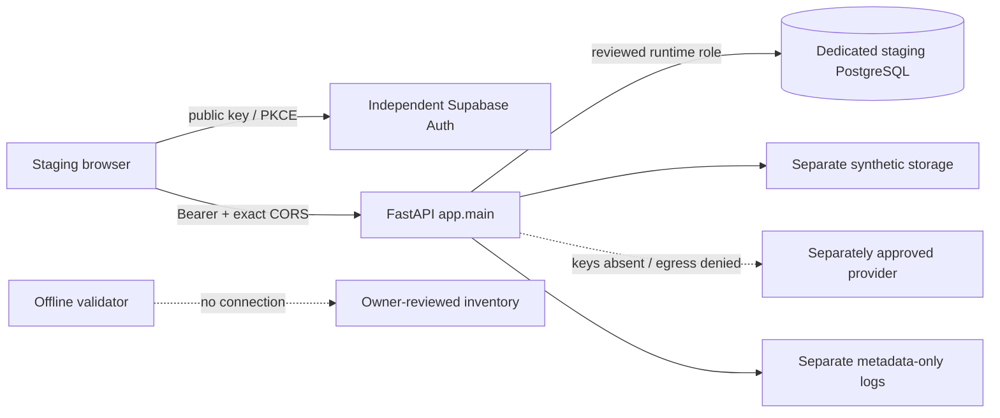

# Independent staging design

Separate DB, Auth project, service credentials, storage and logs; no copied
production records. Migrator, backup and runtime roles differ. Runtime has no
superuser, ownership or BYPASSRLS. Before an authorized connection, independently
review exact host/port/db/role and sslmode=verify-full. Current feedback RLS has no
client policy: grants alone do not make a non-owner role work. Approve and test
the actual role/policy design; local elevated-role tests cannot certify it.

[Inventory template](staging-configuration-template.example.json) is offline
JSON, not .env or provisioning code. Validator rejects known shared/production
identities, mismatched targets, host/options query overrides, unsafe public keys,
unknown env names, callback divergence, test entrypoints and any live budget/key.
It does not load .env, resolve DNS, connect, verify credentials or certify an
operator's approval declaration. An unknown production host falsely labelled as
dedicated cannot be identified without independent inventory review. PASS never
means GO. Malformed values/errors are reported as fixed codes, not echoed secrets.

Default: no AI/storage service keys, assistant disabled, livestock demo, zero live
calls. `deploy_start.py` currently requires AI/storage keys, so it is NOT a zero-key
staging launcher. Owner must approve a separate startup contract or credential/
budget activation before hosted startup. No production workaround added here.
Health is liveness, not DB/Auth/provider readiness.

Publish only apps/web/dist and production API app.main:app. Never expose
tests/stage13_browser_server.py, synthetic JWT routes, .env, source trees or dumps.
Stage14's own-branch Vercel guard prevents this review publication from deploying.
