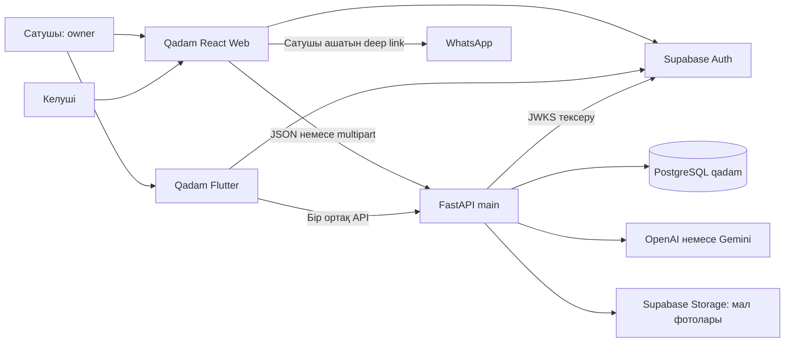
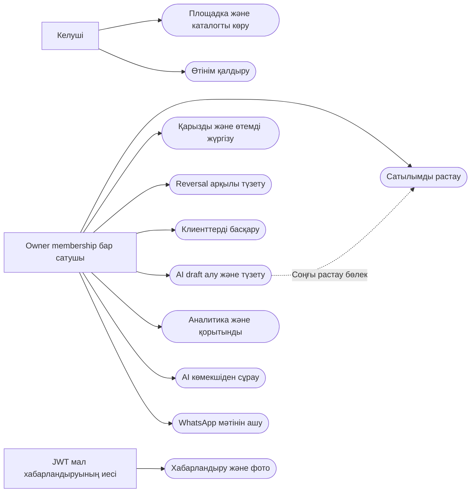
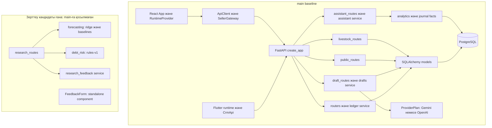
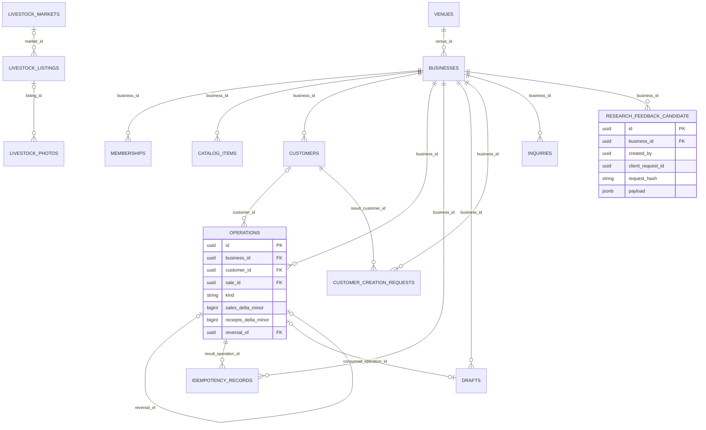
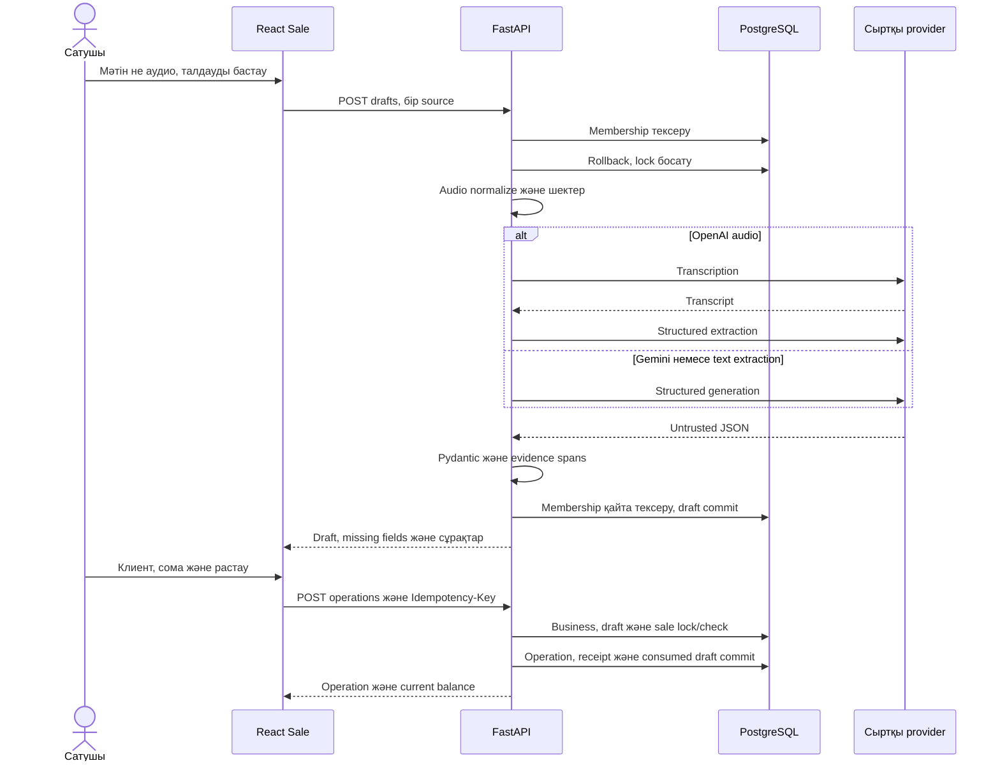
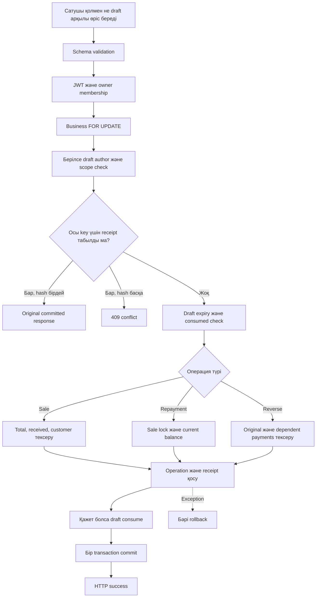
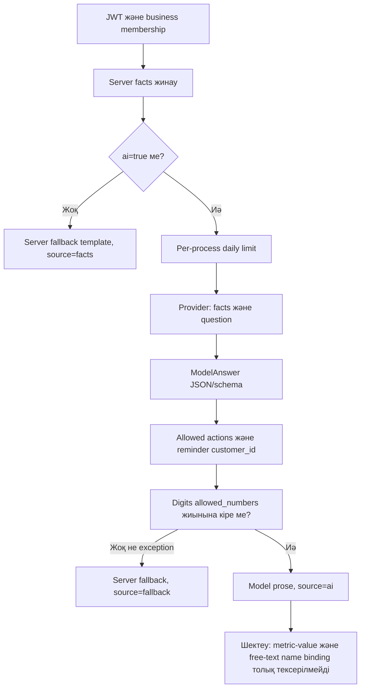

# Архитектура және editable сызбалар

**Тақырып:** «Жасанды интеллект технологиялары негізінде шағын бизнестің сатылымдары мен қарыздарын басқаруға арналған ақпараттық жүйені әзірлеу».

**Нұсқа күні:** 24.10.2026. Негізгі source: `main@2518b2e80b8c`. Зерттеу кандидаты: `feature/ml-sales-debt-research@b7c4750b158a`. Ресми жұмыс/жоба жіктелімі расталмаған.

Web entry [`apps/web/src/main.tsx:37`](https://github.com/foxfordkz-cyber/qadamx-taraz/blob/2518b2e80b8c8ef881063a968645382d61aeb37e/apps/web/src/main.tsx#L37) → App/Auth/Runtime → features → API client. Flutter [`apps/mobile/lib/crm/crm_api.dart:18`](https://github.com/foxfordkz-cyber/qadamx-taraz/blob/2518b2e80b8c8ef881063a968645382d61aeb37e/apps/mobile/lib/crm/crm_api.dart#L18) ортақ endpoints-ке Bearer token береді. Backend [`apps/api/app/main.py:51`](https://github.com/foxfordkz-cyber/qadamx-taraz/blob/2518b2e80b8c8ef881063a968645382d61aeb37e/apps/api/app/main.py#L51) ledger, drafts, assistant, public және livestock router-лерін қосады. Auth — Supabase JWT/JWKS. Ledger SQLAlchemy арқылы PostgreSQL-ге commit жасайды. OpenAI және Gemini httpx adapter-лері server configuration арқылы таңдалады.

Candidate research router [`apps/api/app/research_routes.py:17`](https://github.com/foxfordkz-cyber/qadamx-taraz/blob/b7c4750b158a6b1fc747e63a68ae7b2d078b5107/apps/api/app/research_routes.py#L17) ғана forecast/risk/feedback endpoints қосады. FeedbackForm component-іне import тек өз test-інде табылды; App/router integration жоқ. Candidate docs-та described saved-response/export screen-і код дәлелі ретінде қабылданбайды.

Сызбалар Mermaid source ретінде өңделеді. ER-дегі `RESEARCH_FEEDBACK_CANDIDATE` main entity емес. Use-case Mermaid flowchart арқылы көрсетілген; UML renderer-дің native use-case grammar-ы деп ұсынылмайды.

## 01_system_context.mmd

[Өңделетін source](diagrams/01_system_context.mmd)

## 02_use_cases.mmd

[Өңделетін source](diagrams/02_use_cases.mmd)

## 03_components.mmd

[Өңделетін source](diagrams/03_components.mmd)

## 04_database_er.mmd

[Өңделетін source](diagrams/04_database_er.mmd)

## 05_voice_to_sale_sequence.mmd

[Өңделетін source](diagrams/05_voice_to_sale_sequence.mmd)

## 06_financial_operation_activity.mmd

[Өңделетін source](diagrams/06_financial_operation_activity.mmd)

## 07_assistant_validation_current.mmd

[Өңделетін source](diagrams/07_assistant_validation_current.mmd)

## Stage1 local overlay

[08 improved validation](diagrams/08_improved_ai_validation.mmd) implementation `6ac5266abddffa7f1278d403ece55cc3eba457a1` үшін. Main/candidate source links historicalbaseline болып қалады;current privateprotocol ID-only,server rendering.
