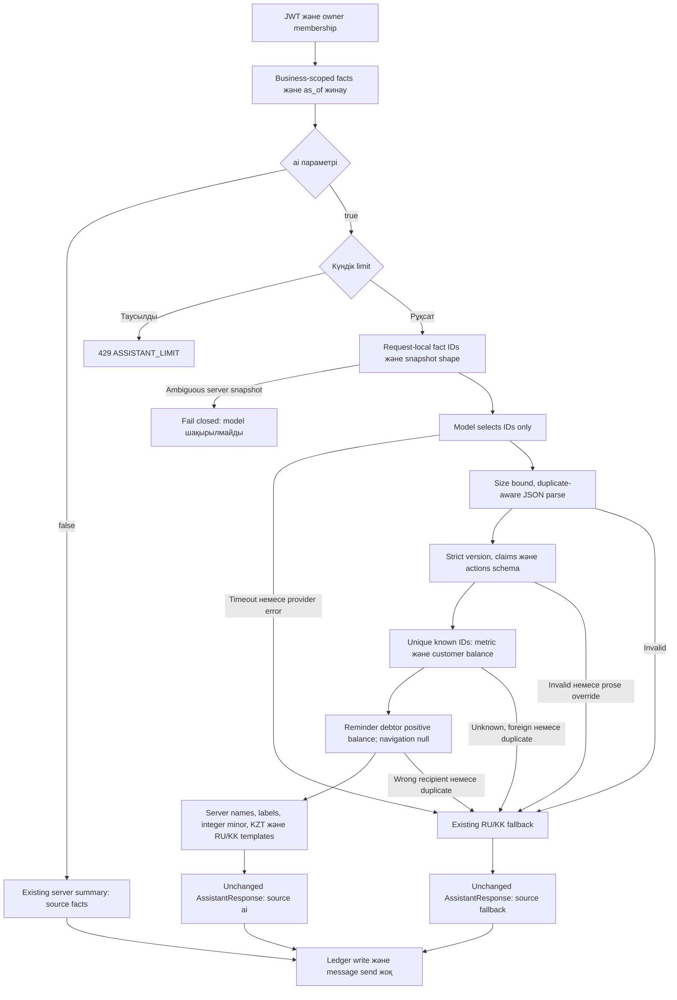

# Stage1 implementation — орындалған өзгерістер және тексеру

**Тақырып:** «Жасанды интеллект технологиялары негізінде шағын бизнестің сатылымдары мен қарыздарын басқаруға арналған ақпараттық жүйені әзірлеу».

24.10.2026. Local branch `feature/stage1-factual-validation`;base main `2518b2e80b8c8ef881063a968645382d61aeb37e`;implementation `6ac5266abddffa7f1278d403ece55cc3eba457a1`;freeze `3cb1ee19cc43a4b9fe5fcfd8436503cc864dbf8d`. Main/candidate merge немесе deployment жасалмады.


## Нәтиже және source

Stage1actual application code-қа енгізілді. Модель еркін financial prose орнына current request fact ID-лерін таңдайды. Сервер metric label/value,customer name/balance,unit және reminder text-ті өзі құрастырады. Branch local,main/candidate untouched;source commit `6ac5266abddffa7f1278d403ece55cc3eba457a1`. Негізгі main `2518b2e80b8c8ef881063a968645382d61aeb37e`,unmerged later-stage candidate `b7c4750b158a6b1fc747e63a68ae7b2d078b5107` (main-only0/candidate-only4) fetch арқылы қайта расталды. Кейінгіforecast/risk/feedback коды көшірілген немесе қайта implement етілген жоқ.

## Нақты code changes

| Файл | Өзгеріс |
|---|---|
| apps/api/app/services/assistant_structured.py | Жаңа strict private contract,request-local fact catalog,duplicate-aware parsing,binding,RU/KK deterministic rendering |
| apps/api/app/services/assistant.py | Old numeric/prose validation runtime-нан алынды;provider schema/instructions және model payload ID catalog-қа ауысты;server shop reminder rendering-ке беріледі |
| apps/api/tests/test_assistant.py | Valid provider stubs structured IDs-ге көшті;existing fallback/limits/facts-mode checks сақталды;DB test before/after operation money fields салыстырады |
| apps/api/tests/test_assistant_semantics.py | Frozen42 +boundary/type/tenant/read-only/provider/HTTP/zero/signed-delta/LF-checkout regressions |
| apps/api/tests/fixtures + evaluation_baselines | 18valid/24invalid paired payloads және immutable original validator;freeze-before-code commit |
| apps/api/tools/diploma_eval/evaluate_stage1.py | Offline original-v2 comparison;rawCSV/JSONL,metrics,config,commit/dirty status және raw/LF source hashes |
| packages/contracts/ASSISTANT_API.md | Private implementation/source semantics түсіндірілді;machine-readable API contract өзгермеді |

## Private protocol және trust boundary

```json
{"version":"fact-bindings-v1","claims":[{"fact_id":"metric:sales"}],"actions":[{"kind":"open_analytics","fact_id":null}]}
```

1–4unique claims;0–3unique actions. `metric:<key>` текserver metric-ке;`debtor:<uuid>:balance` текосыsnapshot customer-іне байланады. Navigation fact_id=null;reminder current positive debtor factID. Модель value_minor,count,currency,label,customer_id,answer,text бере алмайды;extra fields rejected. Unknown/foreign IDs,duplicate keys/claims/actions,malformed JSON,null/boolean fact IDs,missing facts және contradictions fail safely. Shape valid болып,question-ға irrelevant allowed fact таңдалса factual label/value дұрыс қалады,бірақ relevance кепілі берілмейді.

Дубликат/shape қатесі бар **server snapshot** provider шақырмай fail closed болады;қате provider output existing fallback-қа түседі. Server-catalog corruption fallback data-ны қауіпсіз деп жорамалдамайды. Normal collector required facts береді,collector code өзгермеді. Metric label server key бойынша;customer name visibly quoted/control characters escaped. Signed `sales_change`,receipts,today_sales/today_receipts сақталады;ескі sale-ды бүгінreverse ету нәтижесіндегі negative daily delta clamp жасалмайды. Model sign/unit override rejected.

## Архитектура сызбасы

[Editable Mermaid](../02_System_Design/diagrams/08_improved_ai_validation.mmd)



## Нақты before/after

| Көрсеткіш | Original numeric v1 | fact-bindings-v1 |
|---|---|---|
| TP | 18 | 18 |
| FP | 19 | 0 |
| TN | 5 | 24 |
| FN | 0 | 0 |
| False acceptance rate | 0.791667 | 0.000000 |
| False rejection rate | 0.000000 | 0.000000 |
| Precision | 0.486486 | 1.000000 |
| Recall | 1.000000 | 1.000000 |
| F1 | 0.654545 | 1.000000 |

Full [experiment report](../03_Datasets_and_Experiments/stage1_experiment_results.md) және raw per-case files бар.42case synthetic/paired representations;new_FP0/FN0 осы finite set-тің шегінде ғана. Live LLM accuracy100% деп айтылмайды. Duplicate/strict-type policy cases original financial falsehood-пен теңестірілмейді;category analysis experiment report-та бар.

## Compatibility және financial safety

- Public AssistantRequest/Response,action kinds/source enum,Auth/membership routes,OpenAPI/examples/generated TS byte-unchanged;export check passed.
- `source=ai` — модель қатысқан таңдау+server rendering;`fallback` — тексеру/provider failure кезіндегі бұрынғы template;`facts` — ai=false,model/quota call жоқ. Existing frontend өзгермеді.
- Collector,fallback,DailyLimit,provider transport bodies,response helper және movedtenge/reminder helpers AST-ы бұрынғымен тең. 827 өзге trackedapps/packages file өзгермеген.
- Ledger/customer/model/schema/migrations өзгермеді. Жаңа module SQLAlchemy/session/HTTP/messaging импорттамайды. Unit traps Session.add/commit/execute және ledger.write_operation шақырылса fail етеді;passed.
- Business facts membership тексерілген collector-дан алынады;ID lookup current request-та ғана. Cross-business ID rejected. HTTP tests stub collector-ға business/user берілгенін тексереді,нақты DB RLS/isolation execution деп аталмайды.
- WhatsApp reminder — server-generated draft;автоматты message send жоқ. No paid/live AI,production DB,shared migration,deploy немесе main merge.

## Тексерулер

| Тексеру | Нәтиже | Шектеу |
|---|---|---|
| Final backend non-Postgres | 318passed;32skipped;129deselected;1warning | PostgreSQL suite executed емес |
| Assistant subset in final JUnit | 108passed | Includes frozen42 +stubbed HTTP/providers |
| Web assistant/WhatsApp | 57passed;3files | Existing Auth/runtime/API doubles;no live browser or phone |
| API export/Ruff/format | Passed | Pinned project environment;Python static typechecker configured емес |
| Web check:api/TypeScript/ESLint | Passed | Frontend source unchanged |
| Initial assistant development run | 103passed;1failed;5deselected | Escaped newline assertion түзетілді;failed log сақталды |
| Real DB/Flutter/live AI | Not run | Local Docker daemon unavailable;no external service fallback |

Logs/configs: `../03_Datasets_and_Experiments/stage1/checks/`. Code protection evidence `stage1_code_guard.json`;source hashes final check JSON жәнеcomparison config ішінде. Жұмыс барысында жеткен315/317counts development logs ретінде ғана,final318-ге қосылмайды.

## Rollout,rollback және қалған шектеулер

Бұл local feature branch;PR/remote publication/deployment жасалмады. Review кезінде main-нан алған base/candidate refs қайта салыстырылсын. Runtime problem болса malformed provider output автоматты fallback береді. Emergency existing `ASSISTANT_ENABLED=false` endpoint-ті404 етеді жәнеUI оны жасырады;unsafelegacy validator-ға автоматты қайту болмайды. `ai=false` enabled assistant-та бұрынғы free summary болып қалады. Арнайы per-AI feature flag немесе миграция қосылған жоқ.

Remaining: real PostgreSQL integration,live provider schema adherence/question relevance/latency,student independent analysis және author attribution. No-data/forecast/risk/user-study кейінгіStage2–6scope. Shared process daily limit restart-та reset болады;as_of snapshot өтпелі transaction-нан кейінгі өзгерісті автоматты жаңартпайды. Public OpenAPI response field shape өзгермегенімен еркін model wording controlled templates-ке ауысты;UI exact sentence-ке тәуелді емес.

## Жеке үлес және AI disclosure

Stage1 code/tests/synthetic cases/evaluation/docs Codex AI көмегімен орындалды;local commits Codex (`codex@local.invalid`) ретінде ашық белгіленген. Бұл current студенттің жеке авторлығын немесе team code түгел соған тиесілі екенін растамайды. Студент own design decisions/edits/validation/interpretation-ды бөлек commits жәнеsupervisor confirmation-мен тіркейді. Research source selection мен final thesis conclusions independently тексерілуі тиіс. Толық диплом тараулары автоматты жазылған жоқ.
