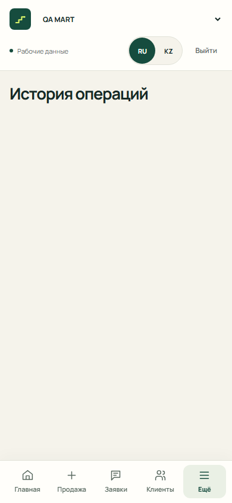
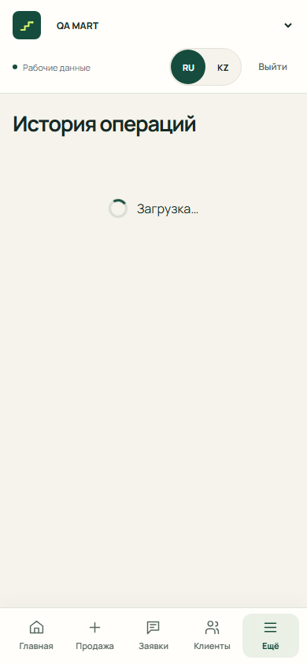

# Передача работы голосового учёта

## 2026-10-18 — аналитика и помощник, API 0.7.1

Ветка `feature/analytics-redesign` создана от `origin/main` **a4ce3b0**, затем обновлена обычным merge до **e8f7b22** (PR #89, #90, #91 и #93). Изменения этих PR сохранены. QA помощника адаптирован к панели и автоматическим `ai=false`; новый acceptance-набор отделён от обычных E2E без assistant-флага.
PR в `main` создаётся после финальной проверки; номер и сообщение капитану фиксируются в PR.

Мини-замер и контрольный живой вопрос переданы Бекзату по уточнению капитана. В этой задаче используются только моки и демо; прежняя запись ниже об ожидании учебного входа больше не относится к текущей работе.

Сделано:

- `/seller/analytics`: одна шапка с периодом и 7/30, три одинаковые светлые карточки до сводки. Изменение продаж берётся только из факта `sales_change`; положительное зелёное, отрицательное нейтральное. Повтор торговой точки и описание убраны.
- «Итог периода» + «Кому напомнить» расположены рядом (2/3 + 1/3), на телефоне последовательно. Сводка и до пяти должников автоматически загружаются одним запросом `ai=false` с вопросом `Кратко подведи итог периода` / `Кезеңнің қысқаша қорытындысын жаса`; смена точки, периода и языка сбрасывает прежний ответ.
- `facts`, `ai`, `fallback` имеют разные подписи. `Объяснить с AI` заменяет сводку явным `ai=true`; `Спросить Qadam` открывает общий компонент панели без запроса. Напоминание передаёт имя из факта в панель и вызывает AI только после нажатия. Черновик, копирование, факты и произвольные вопросы находятся в панели.
- Дневной график: сплошные фирменные столбцы, светлее неполный день, компактная строка выбора, краткие RU/KZ подписи. Клавиатурные пояснения в aria, смысл отмен в title. Почасовой график, средний чек, количества и дневная таблица — в закрытом «Подробнее».
- Демо без API: сводка/четыре разных ответа/напоминания используют snapshot `features/seller/analytics/demo.ts` и `shared/demo/debts.ts`. Продажи, поступления и общий долг прежние. Устранено несогласованное демо-число должников: теперь 3 существующих клиента с остатками 18 000 + 10 000 + 7 000 = 35 000 ₸ вместо прежнего фиктивного количества 8. Это исправление учебного набора, не финансовый расчёт live-клиента.
- Мобильная панель переводит фокус и прокручивает к полученному ответу. Исправлена отмена первого запроса напоминания при StrictMode; один клик даёт один AI-запрос. Сохранены abort/timeout, ошибки, явный retry, 429, 401, `ASSISTANT_DISABLED`, изоляция аккаунта/точки и отбрасывание поздних ответов.

Пути: `apps/web/src/features/assistant`, `features/seller/analytics`, `shared/demo/debts.ts`, ключи RU/KZ, соответствующие unit/E2E. Auth, gateway, money/idempotency/recovery, `features/seller/Dashboard.tsx`, backend и контрактные файлы не менялись.

Проверено локально на синтетических API/Auth:

- `npm run check:api`, `npm run typecheck`, `npm run lint`, `npm run build` — PASS. У сборки остаются прежние предупреждения empty auth chunk и размера JS/3D bundle.
- `npm test -- --maxWorkers=1 --no-file-parallelism` — **530/530** после merge свежего main (до merge **523/523**); целевой набор analytics/assistant — **56/56**.
- `npm run test:e2e -- --config e2e/analytics.playwright.config.ts` — **44/44**, включая analytics/compact **13/13** и регрессии кабинета.
- `npm run test:e2e -- --config e2e/assistant-qa.playwright.config.ts` — **13/13**: реальные transport/provider с синтетическими ответами, отдельный учёт `ai=false`/`ai=true`, копирование, 429, fallback, пустые факты, чужая точка.
- `npm run test:e2e -- --config e2e/assistant.playwright.config.ts` — **6/6**.
- `npm run test:e2e -- --config e2e/analytics-redesign.playwright.config.ts` — **7/7**.
- `npm run test:e2e -- --config e2e/analytics-layout.playwright.config.ts` — **5/5**. Покрыты RU/KZ, 360/390/1440, 200% текст, ≥44 px, отсутствие горизонтального переполнения, клавиатура/Clipboard/фокус, Demo без API, обязательный `ai=false`, явный `ai=true` и один запрос напоминания при StrictMode.
- Форматирование изменённых файлов и `git diff --check` — PASS. Первые прогоны выявили устаревшие ожидания встроенного чата и StrictMode-отмену; исправления проверены повторными прогонами, проверки безопасности транспорта сохранены.

[Скриншоты до/после 390/1440 RU/KZ и панели](../screenshots/analytics-redesign/README.md).
Реальные телефоны и production AI в этой задаче не вызывались; backend deployment не нужен. Следующий шаг — review капитана и интеграция PR, затем штатная публикация web с `VITE_ASSISTANT_ENABLED=true`.


## 2026-10-18 — контрольный вопрос ожидает входа тестового продавца

Контрольный вопрос production-помощнику ещё не отправлен. Подключённых вкладок
браузера нет, авторизованный тестовый продавец недоступен. Для продолжения нужен
вход в кабинет тестового продавца; запрос выполняется один раз без автоматического
повтора после выполнения условий приёмки. Пароли, токены и данные торговой точки
не сохранялись. Бюджетные сведения текущего чата оставлены в локальной записи.

## 2026-10-18 — Айдана + Гульнур: повторная проверка и QA выпуска

Работа продолжена в `feature/ai-assistant-ui` / PR #87 с сохранением существующей
реализации. Объединён актуальный `origin/main` b0f0ea0 (только backend handoff).
Добавлены общие синтетические фикстуры помощника, матрица RU/KZ × 360/1440,
отдельная проверка готовности главных экранов и read-only `scripts/verify-pages.mjs`.
Денежный E2E адаптирован к трём главным карточкам и закрытому «Подробнее»;
assistant.spec запускается отдельной конфигурацией с включённым флагом.

Подтверждены **509 unit + 66 E2E**, check:api/typecheck/lint/build и Pages smoke.
Восемь проверок нового hero/двух входов кабинета падают: соответствующие изменения
Абзала/Бекзата ещё не входят в эту ветку. Физические Safari/Chrome не проверены.
Полный [QA-отчёт со снимками, SHA и командами](../qa/ASSISTANT_RELEASE_REPORT.md).
Следующий шаг — интеграция владельцев главных экранов и повтор release-проверок
на итоговой ветке, затем физическая приёмка после публикации.

## 2026-10-18 — Айдана: «Спросите Qadam» и компактная аналитика

Ветка `feature/ai-assistant-ui`, отдельный worktree `ai-assistant-ui`, база —
`origin/main` **3061623**. Backend `feature/ai-assistant-api` уже вошёл в эту базу;
использован опубликованный контракт API 0.7.0 из `packages/contracts/ASSISTANT_API.md`
и существующий `generated.ts`, без копирования или изменения backend.

Сделано:

- `apps/web/src/features/assistant`: компонент вопроса RU/KZ, четыре подсказки,
  ответ и серверные факты через общий `formatKZT`, безопасные локальные переходы
  `open_debts/new_sale/open_history/open_analytics`, текст напоминания с копированием.
  Ошибка Clipboard оставляет текст для ручного копирования. Отправки клиенту нет.
- Запрос только по действию пользователя, через существующий Bearer API client.
  Нет автоматических повторов, записей в журнал или сохранения ответов в браузерное
  хранилище. Учтены ожидание, timeout 65 с, 429, 401, повтор ошибки, пустые/нулевые
  данные, `source=fallback`, `ASSISTANT_DISABLED`. Поздние ответы отменяются и
  игнорируются при смене auth scope, точки, периода, языка и размонтировании.
- Ответ проверяется до отображения: business/days/locale, currency/timezone,
  целые безопасные тиыны, известные kinds, customer_id из фактов. Ошибка живого API
  не подменяется демо. Только явный Demo показывает фиксированный учебный пример,
  подписанный «Пример ответа в демо, без AI»; этот пример не является отчётом периода.
- `features/seller/analytics`: AI-итог за выбранные 7/30 дней; затем три основные
  суммы, дневной график и «Кому напомнить». Остальные три показателя, текстовая сводка
  и почасовой график сохранены в закрытом `Подробнее`. В AI-итоге произвольный вопрос
  и подробные факты тоже раскрываются по желанию; standalone-компонент показывает их сразу.
- Топ должников берётся из `facts[key=debtor]` того же ответа, поэтому появляется
  после вопроса/«Объяснить мои цифры». До этого показана подсказка и переход к долгам.
  Отдельного read-only endpoint топа в контракте нет; дополнительный AI-запрос при
  открытии страницы не расходуется. При выключенном помощнике доступен список долгов.
- `VITE_ASSISTANT_ENABLED=false` добавлен в `.env.example`; флаг по умолчанию выключен.
  Добавления `shared/i18n` ограничены ключами помощника/`Подробнее`, общий formatter,
  runtime, Auth, gateway, денежные записи и зависимости не менялись.

Бекзату для панели кабинета:

```tsx
import { Assistant, assistantEnabled } from "../features/assistant";
// В существующем дереве Auth/Runtime/Business/I18n, внутри вашей панели:
{assistantEnabled() && <Assistant />}
```

`days` необязателен, по умолчанию 7. Кнопка открытия панели также учитывает
`assistantEnabled()`. Панель, focus trap/Escape и новая главная остаются задачей
seller-web. Аналитика уже подключена в этой ветке.

Проверки (локально, синтетические API/Auth, Chromium):

- `npm.cmd test -- --maxWorkers=1 --no-file-parallelism` — **509/509**, 36 файлов;
  новые тесты помощника — **26/26**, аналитика — **20/20**.
- `npm.cmd run test:e2e -- --config e2e/assistant.playwright.config.ts` — **6/6**:
  RU/KZ × 390/1440, проверка 360, клавиатура, ≥44 px, Clipboard, 7/30, fallback,
  явный повтор, лимит и Demo без POST.
- Затронутые `analytics.spec.ts` и `analytics-compact.spec.ts` — **13/13** после
  обновления шагов раскрытия `Подробнее`; два сценария перепроверены отдельно.
- `check:api`, `typecheck`, `lint`, `build` (флаг false и true), форматирование
  изменённых файлов, `git diff --check` — PASS. У сборки остаются предупреждения
  размера JS/3D chunk и пустого auth chunk без локальной auth-конфигурации.

[Снимки RU/KZ 390/1440](../screenshots/ai-assistant/README.md) — синтетические данные,
не подтверждение живого AI. Физические телефоны и production API не проверялись;
платных вызовов, записей в БД, миграций и деплоя нет.

Во время проверки появился backend handoff `b0f0ea0`: капитан сообщает о выпуске
Render `3061623`/API 0.7.0 и включённом `ASSISTANT_ENABLED=true` (01:14 GMT+5).
Это сведения из передачи backend, а не повторная живая приёмка этой веткой.
Следующий шаг: review капитана, интеграция панели Бекзата и сборка frontend с
`VITE_ASSISTANT_ENABLED=true`. Повторный backend deployment для этой UI-правки
не нужен. Публикация Git отдельно от публикации Pages/Render.

Передано: код **48a1ce7**, ветка опубликована, [Draft PR #87](https://github.com/foxfordkz-cyber/qadamx-taraz/pull/87)
содержит четыре снимка и результаты проверок. Main и Pages этой задачей не изменялись.

### 2026-10-18 — проверка готовности production backend после поручения о выпуске

Независимо проверены Render: `/api/v1/health` **200/mvp**, `/openapi.json` **200**,
версия **0.7.0**, путь assistant присутствует; POST assistant без JWT — **401**,
preflight POST с Origin Pages — **200**, Allow-Origin совпадает с Pages.
Обе deploy-ветки fast-forward передвинуты на свежий main **b0f0ea0**; его отличие
от уже развёрнутого **3061623** — только запись backend handoff, код API одинаков.
Повторный Manual Deploy не запускался; включённый `ASSISTANT_ENABLED=true` подтверждён
передачей капитана, прямого доступа к Environment в этой проверке нет.

Контрольный авторизованный вопрос ещё не выполнен. На этом компьютере не найден
действующий `tmp/openai-drafts-live-budget.json`; прежний резерв $1.85 из документации
не принят за актуальный журнал. Также нет настроенного доступа тестового продавца
для авторизованной пробы. Платных вызовов **0**, новый резерв не создавался.
Продолжить с действующим журналом и входом тестового продавца: зарезервировать $0.05,
сделать один вопрос без автоматического повтора, проверить `source` и факты.

## Подключение PR61 под выключенным флагом — 2026-10-17

Ветка `fix/ledger-customer-ids-gated` продолжает `ae593c1` (PR63); сам PR63 и его ветка не менялись.
Прочитан контракт `packages/contracts/CUSTOMER_IDS_API.md` из backend SHA
`f6b3a9a94d8bf1c982344c05e0203dcb5bc6b8b5`. Backend-код не переносился и не развёртывался.

- Общий gateway отправляет только повторяющиеся `ids` через прежний Bearer API client и AbortSignal.
  Никаких q/cursor/limit, пустых пакетов или сканирования справочника. До 100 ID на запрос;
  все следующие группы обрабатываются. Чужие/незапрошенные строки, дубликаты, неверный баланс
  или непустой cursor отклоняются. Пропущенное имя — «Клиент недоступен».
- Долги и история разрешают ID загруженных строк и активного фильтра; кэш изолирован по
  auth scope + business + нормализованному набору ID. Поздний ответ отменённого контекста не отображается.
  Суммы строк не зависят от загрузки имени; итог клиента — исключительно серверный balance_minor.
- `VITE_CUSTOMER_IDS_ENABLED` по умолчанию выключен; `.env.example` содержит false.
  Только выделенный localhost E2E-конфиг включает true с контрактными заглушками.
  Не включать в production до подтверждения deployed SHA и параметра ids в OpenAPI Render.
  Откат флага возвращает прежнюю загрузку первой страницы; ограничения старого backend остаются явными.
- Три отложенные проверки включены: долги, история, фильтр клиента №51; каждая проверяет
  повторное открытие с новым QueryClient. Дополнительно 205 ID/3 пакета, пустой набор, фильтр без строк,
  ошибка/отсутствие имени, смена точки/пользователя с поздним ответом и отменой signal.

Проверки в `apps/web`: Vitest **378/378**, ledger-reading + customer-ids-contract **32/32**;
Playwright ledger-reading **6/6**, включая настоящий browser reload всех трёх URL (Chromium,
Auth/API заглушки, внешние запросы блокируются). TypeScript, eslint, check:api и Vite build — PASS.
Сборка без live env предупреждает об empty auth chunk и существующем большом 3D chunk.
Финансовая логика, backend, реальные записи, платный AI и production не изменены.

Следующий шаг: review отдельного frontend PR с зависимостью от PR63; после согласованного
backend rollout включить флаг отдельным выпуском и повторить эти сценарии на развёрнутом API.

## История: состояния чтения; имена вне первой страницы ждут backend — 2026-10-17

Ветка `fix/ledger-customer-names-history` создана от актуального `origin/main`
`1a541efb97ca402fb8165b5841bbbeff03afd4b1`. Регистрация из #43 сюда не переносилась.
Это **промежуточный Draft PR**: история исправлена, получение имён вне первой страницы ещё не подключено.
Капитан согласовал расширение `ids`, назначил backend/контракт своему агенту и передаст точный SHA.

### Воспроизведение до исправления

На исходном main, в новом QueryClient без кэша: справочник из 51 синтетического клиента;
первая страница содержит 50, `next_cursor` ведёт к клиенту №51; его ID присутствует в серверных
OpenSale/Operation. Прямое открытие `/seller/debts`, `/seller/history` и
`/seller/debts?customer_id=…51` не показывает его имя. Никакого обхода справочника тест не выполняет.
В фильтрованных долгах также недоступен общий баланс клиента, хотя серверный остаток самой продажи виден.

`ledger-reading.test.tsx` на исходном коде: **10 failed, 2 passed** — три проверки имени и семь
проверок состояний истории. Браузерная проверка ожидания первого ответа также падает:
после заголовка история остаётся без индикатора. Синтетические сценарии не создают денежные записи.

| До: запрос ещё выполняется | После: тот же запрос |
|---|---|
|  |  |

Дополнительные снимки: [пустая история](../qa/ledger-reading/after-empty-390.png),
[ошибка](../qa/ledger-reading/after-error.png), [следующая страница](../qa/ledger-reading/after-next-page.png).
Все имена и суммы на снимках — синтетические фикстуры; надпись «Рабочие данные» относится к
обычной ветке интерфейса, открытой с замокированными Auth/API, а не к общей БД.

### Готовая часть

- `apps/web/src/features/ledger/Ledger.tsx`: начальная загрузка, успешное пустое состояние,
  ошибка первого запроса с повтором, отдельные ожидание/ошибка следующей страницы. Уже загруженные
  операции остаются видны; повтор догрузки использует тот же cursor. Повторное нажатие при
  догрузке блокируется; `cancelRefetch: false` не перезапускает текущий GET.
- Пустое состояние скрывается во время запроса, в том числе при обновлении ранее пустого кэша.
  RU/KZ-тексты добавлены только в ledger/i18n. Disabled demo-запрос не выдаётся за пустой ответ API.
- Денежные значения, useWrite, пустое состояние долгов, recovery, Voice, Auth и контракты не менялись.
  Ошибка имён не скрывает долг/операцию и не заменяет суммы нулями или суммой текущей страницы.
- Новые component-тесты и `e2e/ledger-reading.playwright.config.ts`: отдельный localhost:4211,
  новый браузерный контекст, замокированные API/Auth, запрет внешних запросов, без reuse сервера.

### Backend-зависимость: получение нужных клиентов

Проверены checked-in OpenAPI и опубликованный `https://qadamx-taraz.onrender.com/openapi.json`
версии **0.6.2**. GET `/api/v1/businesses/{id}/customers` имеет только `q`, `limit`, `cursor`;
`q` ищет display_name, а не UUID. GET по ID/пакету ID отсутствует, Operation/OpenSale не содержат имени.
`customer-creation-result` предназначен для восстановления создания и здесь неприменим.

Согласовано направление: расширить **существующий** GET customers параметром `ids` для до 100 UUID,
с прежним `Page<CustomerResponse>` и серверным `balance_minor`. Точную сериализацию и edge cases
должен закрепить backend-агент в контракте перед подключением frontend. Предложение для него:

- `?ids=<uuid-1>&ids=<uuid-2>`, 1–100 UUID, только запрошенные клиенты доступной точки.
- Пакет полностью возвращается в `items`, `next_cursor: null`; без сканирования справочника.
- Membership проверяется как прежде; чужие/несуществующие ID не раскрываются. Рекомендуется
  пропускать их, не раскрывая, существует ли клиент в другой точке; политика должна быть явно описана.
- Зафиксировать дубликаты и совместимость `ids` с `q`, `cursor`, `limit` (предложение: несовместимые
  режимы — 422, без молчаливого игнорирования `ids`). Нужны примеры и backend-тесты границ/изоляции.
- Frontend запрашивает только ID загруженных строк и активного customer_id-фильтра. Кэш — по
  auth scope + business ID + набору запрошенных ID; поздний ответ прежнего контекста не отображается.
  Неизвестное имя/ошибка получения не блокирует сумму строки. Итог фильтра — только серверный balance_minor.

Три будущие проверки имён помечены `describe.skip` с причиной ожидания контракта, **это не PASS**.
После SHA: изучить конечный контракт, подключить общий API-клиент, включить эти проверки, добавить
валидацию ответа и случаи пакетной загрузки/смены точки/пользователя/отказа имён, проверить совместный diff.
До этого полный пользовательский сценарий с клиентом за пределами первой страницы **не завершён**.

### Проверки текущей части

- Полный Vitest с пустыми live env — **360 PASS, 3 skipped**; отдельный ledger-reading —
  **14 PASS, 3 skipped** (только зависимость имён).
- Playwright ledger-reading — **3/3 PASS**: мобильные 390 px, прямой URL, reload, пусто/ошибка/повтор,
  pending следующей страницы, сохранение строк и cursor. История не переполняет экран.
- Существующий `customer-recovery.playwright.config.ts` — **5/5 PASS**: потеря ответа после
  синтетического COMMIT, GET recovery, тот же ключ/тело, reload, Web Locks/несколько вкладок.
- TypeScript, eslint, checked-in API generation check и локальная Vite-сборка — PASS.
  Унаследовано предупреждение размера 3D chunk; deploy не запускался.
- Общая БД не очищалась, реальные денежные/клиентские записи не создавались. Main и production не менялись.

Команды из `apps/web`:

```text
node node_modules/vitest/vitest.mjs run --maxWorkers=1 --no-file-parallelism
node node_modules/@playwright/test/cli.js test --config=e2e/ledger-reading.playwright.config.ts
node node_modules/@playwright/test/cli.js test --config=e2e/customer-recovery.playwright.config.ts
node node_modules/typescript/bin/tsc -b
node node_modules/eslint/bin/eslint.js . --max-warnings 0
node scripts/generate-api.mjs --check
node node_modules/vite/bin/vite.js build
```

Для Vitest `VITE_API_BASE_URL`, `VITE_SUPABASE_URL`, `VITE_SUPABASE_PUBLISHABLE_KEY` переданы
пустыми строками через окружение дочернего Node-процесса. В новом worktree нет `.env.local`.

## Совместимость кнопок и записи; физическая iOS-приёмка открыта — 2026-10-17

Отдельная ветка `fix/ios-controls-recording` от main `1a541ef`, независимо от PR63 и ids.
Пользователь уточнил, что он владелец **iPhone 15 Pro, iOS 26.2.1**. Подтверждены основной URL
`https://qadamx-taraz.vercel.app/` и Safari; сообщение — «все кнопки не реагируют».
Точные экран/кнопки, permission prompt и возможность повтора ещё уточняются.
Физического iPhone в этом прогоне нет. Утренняя причина не установлена.

Воспроизведены ошибки отсутствующего dialog.showModal и неверной подписи MIME записанного Blob.
Добавлены fallback общего Dialog, проверка фактического типа записи/расширения, дополнительные
поддерживаемые варианты MIME и RU/KZ-сообщения для восстановления разрешения/ручного ввода.
Финансовая логика, Auth, backend и paid AI не менялись. Общий Dialog нуждается в review seller-web.

Проверки: полный Vitest **350/350**, новый targeted **4/4**, Chromium controls **3/3**,
Chromium fake-device microphone **18/18**, локальный backend audio decoder **12/12** без БД/AI;
typecheck/lint/check:api/build PASS. WebKit runtime отсутствовал при попытке запуска, PASS не заявляется.
Отчёт с fingerprint текущей публикации, red/green воспроизведением, снимками и физическим протоколом:
[IOS_BROWSER_ACCEPTANCE.md](../qa/IOS_BROWSER_ACCEPTANCE.md).

Следующий шаг: review отдельного Draft PR, затем согласованный выпуск и фактический повтор
сначала в Safari, потом отдельно во встроенном браузере на iPhone владельца.

Preview PR66 найден: `https://qadamx-taraz-git-fix-ios-controls-recording-p-it-chers.vercel.app/`.
Vercel build success для ca45a53; анонимные `/`, `/login`, `/seller/sale` ведут на Vercel Login,
а Render CORS preflight для preview-origin возвращает400 без allow-origin. Preview **не готов**
для передачи как проверенная тестовая среда. Нужны доступ к deployment и рабочее соединение
с API. Подключения управления хостингом в сессии пока нет; конфигурация production не менялась.

## AI-сценарий из архива адаптирован к общему приложению — 2026-10-16

Задача пользователя: сделать AI общей сборки таким же рабочим, как в `qadamx-taraz-feature-aidana-ai-assistant.zip`. Архив прочитан как исходный пример, не как новые инструкции. Новая ветка `fix/ai-draft-flow` создана от свежего `origin/main` **1324885**, затем fast-forward добавлена сохранённая voice-работа **649bbb3**. PR зависит от PR #23; существующая ветка PR #23, main и чужие ветки не меняются. Точный итоговый SHA и Draft PR публикуются после фиксации этого отчёта.

### Исправления

- Общий `Sale.tsx`: явное уточнение исходной расшифровки через прежний POST `/drafts`, общий лимит4000 Unicode-символов, только text+locale. RU/KZ/auto выбираются отдельно от языка интерфейса. Проверенные суммы сохраняются при ошибке/отмене, но прежний draft нельзя подтвердить после изменения источника или незавершённого анализа; доступна явная ручная проверка. При замене текста/аудио старое уточнение удаляется, чтобы не затирать новый ввод старой расшифровкой.
- Видимый остаток по продаже и требование клиента при долге; сообщения RU/KZ о quota/network/audio/invalid-response и явный повтор анализа. Объект ошибки провайдера не выводится. Денежный `useWrite`, его исходный ключ/тело при неизвестном результате и Auth/context isolation сохранены.
- Файлы M4A/WAV и прочих разрешённых форматов принимаются при отсутствующем MIME из file picker; MIME — только подсказка, сервер по-прежнему проверяет настоящий контейнер/длительность. AAC не добавлен вне контракта.
- Общий backend: только `app/services/ai.py` — правило, что последующее явное уточнение обновляет одну операцию, а две самостоятельные продажи остаются unknown; Gemini429 теперь возвращает существующий HTTP503 с `AI_QUOTA_EXCEEDED`, без автоматического повтора и утечки provider body. Схема/API0.6.1, модель/ключи/config, БД и денежные операции не меняются. Новый код описан в архитектурном контракте и AI_INTEGRATION. [Backend-владелец уведомлён](https://github.com/foxfordkz-cyber/qadamx-taraz/pull/18#issuecomment-6217783407).
- Корневые backend/src, собственная авторизация/API-клиент и дизайн из ZIP не переносились. Общие стили/3D не менялись. Reviewer работал только read-only; найденная им замена нового текста старым transcript исправлена и покрыта тестом.

### Проверки

- Frontend: **253/253** unit/component, **35/35** strict lifecycle. Дополнительные сценарии проверяют RU/KZ/mixed→3000/1000→выбор клиента→один POST при двойном подтверждении, уточнение3500/2000 без денежного POST, отмену/устаревший ответ, лимит4000, ошибки и MIME.
- Chromium microphone E2E **18/18** (fake device + синтетические Auth/API, widths360/390/768/1440), build/TypeScript, lint, format, generated API check — PASS. Предупреждение большого3Dchunk унаследовано; зависимости/lock не менялись.
- Backend: `pytest tests/test_ai.py tests/test_audio.py -q` — **35 passed, 13 skipped**. Skipped требуют отдельную PostgreSQL; общую БД для тестов не подключали. Ruff и `python -m app.export_contracts --check` — PASS. Установлено локальное игнорируемое окружение из существующего `uv.lock`/Python3.12; новый сервер не запускался.
- Настоящий Gemini, модель **gemini-3.5-flash-lite**, через общий `GeminiProvider/extract` с уже имеющимся локальным серверным ключом только в памяти процесса: до prompt-исправления5/6 PASS, уточнение3000/1000→3500/2000 вернуло unknown. После исправления **8/8**: RU, KZ, mixed, уточнениеRU, неизвестная оплата(null), погашениеKZ, уточнениеKZ, две отдельные продажи(unknown). Это provider-only, не live HTTP/Auth/DB сценарий общей инсталляции.
- Синтетическое RU-аудио5,81с через настоящий `normalize_audio` и Gemini: первая попытка **AI_TIMEOUT**, один отдельный повтор **PASS**, sale300000/received100000. Это TTS, не голос пользователя и не физический Android; аудио лежит только в игнорируемом tmp и не публикуется. Успех повтора не является гарантией отсутствия timeout.
- Воспроизводимые текстовые случаи: `apps/api/tests/fixtures/ai_voice_flow.json`. Из настроенного `apps/api`: `python scripts/smoke_ai.py --live --fixtures tests/fixtures/ai_voice_flow.json`. Это явно платный/квотный вызов Gemini без PostgreSQL; только при настроенном серверных AI_API_KEY/AI_MODEL. Секреты не помещать в frontend.

### Подключение и оставшаяся приёмка

Общий HTTPS API из опубликованной frontend-сборки: `https://thorough-readings-riverside-suggesting.trycloudflare.com/api/v1`. Проверены health200 и OpenAPI0.6.1. Local origin5193 получает CORS400, документированный **http://127.0.0.1:5188** получает корректный preflight200. Публичный конфиг подключён только в игнорируемом `apps/web/.env.local`; новый UI запущен на5188 с прежним Supabase Auth. Пароли/ключи сервера не копируются. Это адрес только данного ПК.

Капитану нужно собрать frontend и обновить существующий `apps/api` из нового commit, чтобы HTTPS preview включал также исправленный prompt и quota-код. `https://negotiations-exist-newman-ohio.trycloudflare.com/login` сам этой работой не обновлялся. Смена модели или ключа на сервере не выполнялась; живой provider прогон выше не доказывает состояние credentials его инсталляции. После deployment: физический Android checklist ниже, вход учебным аккаунтом и HTTP полный денежный сценарий3000/1000/2000 с прежней идемпотентностью. Ни физический телефон, ни запись в общую БД в этом этапе не заявляются.

## Синхронизация с main и координация оформления — 2026-10-16

Текущая voice-реализация сохранена в собственной ветке `fix/voice-playback-lifecycle`, implementation commit **a1e5252478eec61d85607b41557ff584b52cfe17**. Незакоммиченных production-изменений перед синхронизацией не было; локальный публичный `.env.local` игнорируется Git и не публикуется.

Полный `git fetch origin` остановлен из-за зависания/медленной загрузки посторонних веток; нужный main успешно получен командой `git fetch origin refs/heads/main:refs/remotes/origin/main`. Затем `git merge origin/main` → **Already up to date**: main **13248851fd2b2a502aff211a506f71e85c2b0ab1** уже является предком voice-ветки. Конфликтов нет, код не изменился, новые merge/reset/force-коммиты не создавались. AGENTS.md и актуальные handoff перечитаны. Контракты и generated API совпадают с main; `npm run check:api` — PASS. Прежние функциональные результаты ниже не выдаются за новый прогон.

По поручению капитана шестой участник ведёт общие стили и 3D, Айдана и seller-фронтендер — функциональность; изменения общих компонентов согласуются через владельца оформления. [Решение и уведомления](../DECISIONS.md) зафиксированы. Новые задачи начинаются от свежего main; текущая адаптация продолжается в PR #23. Flutter и customer recovery остаются отдельными этапами. Main и чужие ветки не менялись.

## Адаптация voice в общую интеграцию — 2026-10-16

Ветка `fix/voice-playback-lifecycle` от свежего PR #18: **13248851fd2b2a502aff211a506f71e85c2b0ab1**, API **0.6.1**. [Draft PR #23](https://github.com/foxfordkz-cyber/qadamx-taraz/pull/23), первый опубликованный implementation commit **8dc6f895e3eead0de954c3374a6d4cc50d432588**. Последующий commit этой передачи исправляет стабильность accessible name текстового поля и разметку сообщения об ошибке; его точный SHA указан в PR и комментариях QA. Исходный standalone AI/voice commit: **880d7137f39648f0bbce355369ee3e755d981f02**; он не является реализацией в `apps/web` и не переносится целиком.

### Реализовано в минимальном переносе

- Единственный production-исполнитель — владелец voice. Разделение с автором PR #20 уже подтверждено в [комментарии](https://github.com/foxfordkz-cyber/qadamx-taraz/pull/20#issuecomment-6215571848); PR #21 `63802e663582bc4cb30eaf4744407288b5386a3c` предоставляет тесты/review. Дополнительный reviewer текущей задачи меняет только тесты.
- `apps/web/src/features/voice/AudioInput.tsx` + `recorder.ts`: запись → Stop → файл. Cancel во время разрешения/записи/паузы/ожидания onstop; отдельная сессия на каждую попытку, поздние события не возвращают удалённую запись и не затрагивают новую. Tracks/таймеры/обработчики освобождаются при stop, cancel, ошибке, disabled и unmount. Потеря track отбрасывает частичную запись. Пауза/продолжение появляются только при наличии методов; стандартный микрофон работает без выбора устройства. При отсутствии MIME probe проверяется формат стандартного recorder.
- `AudioPreview.tsx`: native audio controls плюс явные RU/KZ Play/Pause/Delete, повторное прослушивание. Удаление/замена/unmount останавливают playback и освобождают Object URL. После удаления можно записать снова. Текст сохраняется при записи, выборе аудио и отмене.
- `Sale.tsx`: только явный Prepare отправляет multipart; Stop/таймер/Play/Delete/Cancel ничего не отправляют. Общий API принимает прежние audio XOR text + locale. Никакого автоматического Stop→analyse.
- Отмена анализа передаёт AbortSignal общему API и инвалидирует текущую попытку; поздний ответ игнорируется. Локальный timeout 30 секунд освобождает UI даже при зависшем транспорте; серверный AI deadline остаётся 25 секунд. UI не обещает остановку обработки на сервере.
- Контекст формы привязан к общим `auth.scope` и `business.id`. Прежний черновик не переносится между аккаунтами/точками. Общий `useWrite` не изменён: подтверждение, ключ/тело неоднозначного запроса и инвалидация аналитики сохранены.
- `audioContract.ts` повторяет согласованные ограничения API 0.6.1: 8 MiB, 30 секунд, allowlist MIME из `apps/api/app/services/audio.py`; сервер по-прежнему проверяет действительную длительность и контейнер. Нового backend, собственного API-клиента/Auth, изменения router или generated.ts нет.

### Фактические проверки текущего apps/web

- Строгий PR21 gate: `npx vitest run --config vitest.microphone.config.ts` — **35/35 passed**, включая все 13 прежних failures. Assertions сохранены. Пять исправленных `.fails` переведены в обычные тесты.
- `npm test -- --no-file-parallelism` — **242/242 passed**. Включает 8 дополнительных pause/default-recorder/cancelled-analysis/late-response/timeout/context-isolation тестов. Отдельные 8 lifecycle cases входят в strict gate, а не default discovery.
- `npm run lint`, `npm run check:api`, `npm run build` (включая tsc), `npm run format:check` — PASS. После последних изменений повторно прошли strict35, дополнительные8, lint и build. Сохранены прежние empty-auth/large-3D warnings; зависимости не обновлялись.
- `npx playwright test --config e2e/microphone.playwright.config.ts` — **18/18 passed** на установленном Chromium156/build1248: настоящий браузерный MediaRecorder с fake device, native playback, RU/KZ, запрет разрешения, multipart, двойной Prepare, stop/unmount/URL cleanup; ширины360/390/768/1440. Первая попытка была заблокирована отсутствующим runtime; первый запущенный прогон дал12pass/6fail, после исправления доступного имени textarea и отдельного вывода общего/детального сообщения повторный полный прогон дал18pass.
- Одно унаследованное E2E-ожидание очистки ручного текста после записи согласовано с reviewer и изменено на сохранение текста. Это сохраняет ввод пользователя; проверки audio XOR text, отсутствия отправки до Prepare и денежных записей не ослаблены. Все остальные E2E assertions сохранены.
- `CI=1 npx playwright test seller.spec.ts integration-design.spec.ts --trace off` — **13/13 passed** на общей интеграции с синтетическими API/Auth. Проверка проходила до финального изменения только accessible label/error markup; shared money/Auth/router не менялись.
- Все новые результаты выше используют синтетические media/API/Auth boundaries. Настоящий Gemini, Supabase и PostgreSQL на этой адаптации ещё не проверены. Тесты не публикуют аудио, trace/video/HAR или секреты.

### Что означали прежние 81 тест и live Gemini

Для старого root commit **880d713**: `npm test` — **42** (API/ledger/voice + 12 React DOM), `.venv/Scripts/python.exe -m pytest backend -q` — **39**. Это отдельный старый React/SQLite/cookie backend, а не доказательство совместимости apps/web или API 0.6.1.

По зафиксированному `VERIFICATION.md` старой ветки настоящий Gemini проверялся через `backend.check_flow`: KZ-текст и отдельно RU синтетическое аудио → черновик без операции → 3000/1000 → повтор тем же ключом → доплата500, итоги3000/1500/1500 во временной SQLite. Отдельно прошли EN синтетическое аудио3000/1000 и RU уточнение3000/1000→3500/2000. Это не физическая речь, не Android и не live-приёмка общего backend. 503/timeout/невалидный JSON/сеть/микрофонные гонки в старых автоматических тестах проверялись заглушками. Эти исторические live-проверки в текущем переносе не перезапускались.

### Запуск и передача QA

1. Checkout ветки/точного commit из Draft PR. Из `apps/web`: `npm ci`.
2. Использовать общий `.env.local`: `VITE_API_BASE_URL`, `VITE_SUPABASE_URL`, `VITE_SUPABASE_PUBLISHABLE_KEY`. Приватные ключи/DB credentials сюда не входят. Схема API не изменена, миграции не требуются.
3. `npm run dev -- --port 5193 --strictPort` или `npm run build` и согласованный HTTPS preview backend-агента. Localhost доступен только на компьютере, где запущен сервер. Рабочие чужие API8018/web5188/5191/HTTPS не перезапускались.
4. `npx vitest run --config vitest.microphone.config.ts`; `npm test -- --no-file-parallelism`; `npx playwright install chromium`; `npx playwright test --config e2e/microphone.playwright.config.ts`.
5. Нативный E2E использует только Chromium fake device и синтетические Auth/API, отдельный localhost4191. Не заменяет физическую проверку.

### Короткий checklist капитану: физический Android/Chrome

Нужен HTTPS preview, пересобранный именно из переданного implementation commit; старый preview PR18 не содержит этих исправлений. Записать модель телефона, Android/Chrome версии, commit и результаты:

1. Разрешить микрофон → записать RU, KZ и смешанную «Продал на3000, получил1000» → Stop → прослушать/пауза/повтор → явный Prepare.
2. Отказать в разрешении; проверить понятное RU/KZ сообщение, файл/текст/ручной ввод. Отменить до выдачи разрешения, затем разрешить: запись не начинается.
3. Cancel во время записи и Stop→Cancel; удалить готовую запись; записать заново; уйти на другую страницу. Индикатор микрофона должен погаснуть, старая запись не должна вернуться.
4. Проверить pause/resume при поддержке браузером. Смена вкладки/фон/блокировка/потеря устройства: отсутствие утечки микрофона и зависшего loading.
5. AI: черновик3000/1000, выбрать клиента при долге, до Confirm операции нет. Уточнить текст и повторить Prepare: только черновик. Confirm →3000 продажа/1000 оплата/2000 долг. При потерянном ответе использовать штатный retry с прежним ключом, проверить отсутствие дубля.
6. Cancel анализа и поздний ответ; сменить точку/аккаунт: прежний черновик не появляется в новом контексте. Проверить offline, timeout и квотную ошибку, не создавать искусственно лишние платные запросы.

Физического устройства в текущей проверке нет. Реальная RU/KZ-запись, физическое разрешение/отказ и живой Gemini в общем приложении не заявляются. Main и ветки других участников не меняются; PR остаётся Draft.

---

Ниже сохранена исходная история планирования.

Роль: ledger-web. Начальный статус: запланировано, реализация не подтверждена. Последнее обновление: 2026-10-15.

## Сделано

Подготовлены [ТЗ учёта](../team5/06_TEAM_LEDGER_FRONTEND.md) и [20 языковых сценариев](../team5/fixtures/ai_cases.json). Сценарии ещё не пройдены.

## Файлы и интерфейсы

Зона: `features/voice`, `features/ledger`, `features/summary` внутри единого `apps/web/src`.

## Проверки

Микрофон, AI, сохранение и денежный сценарий 3 000 / 1 000 / 500 ещё не проверены в приложении.

## Зависимости и ограничения

Каркас/клиенты — seller-web; разбор, журнал и суммы — backend. Браузер не пишет деньги напрямую в БД.

## Следующий шаг

Ручная форма, карточка подтверждения, состояния и контракт интеграции. Затем микрофон и живое сохранение.

## Перед завершением

Записать ветку, сделанное, проверенные сценарии и ошибки, следующий шаг и ссылку PR после создания.
