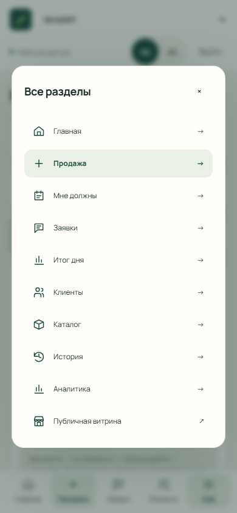
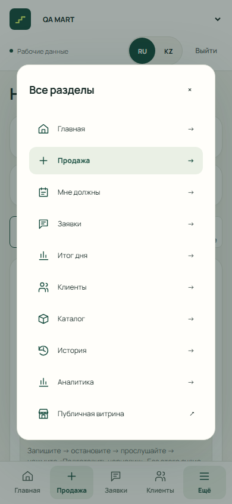

# Qadam: кнопки и микрофон iPhone — 2026-10-17

**Статус инцидента: причина утреннего сбоя не установлена. Физическая iOS-приёмка открыта.**
Пользователь уточнил, что он владелец iPhone 15 Pro с iOS 26.2.1. Проверяли основной
сайт в Safari; по его сообщению «не реагируют все кнопки». Точный экран, конкретные
кнопки, появление запроса микрофона и возможность повторной проверки ещё не подтверждены.
Ни симуляция API, ни Playwright desktop WebKit/Chromium не являются проверкой этого телефона.

## Идентификация

| Поле | Наблюдение |
|---|---|
| Канонический URL из release docs | https://qadamx-taraz.vercel.app |
| Публичный GET 2026-10-17 | HTTP 200 |
| Наблюдаемый fingerprint публикации | `/assets/index-BMQXppQw.js`, `/assets/auth-CB7MGzWB.js`, `/assets/index-C2MiuQKe.css` |
| Точный опубликованный SHA | Не подтверждён: HTML не предоставляет build SHA, GitHub deployments API вернул пустой список. Fingerprint не выдается за commit. |
| URL/версия именно утром | Пользователь подтвердил `https://qadamx-taraz.vercel.app/`; SHA утренней версии не установлен |
| Модель iPhone | iPhone 15 Pro, по данным пользователя — владельца устройства |
| Версия iOS | 26.2.1, по переданным данным экрана «Об этом устройстве»; независимая проверка не проводилась |
| Safari/Chrome/in-app browser | Safari, подтверждено пользователем; встроенный браузер не заявлен |
| Какие кнопки не реагировали, был ли permission prompt | Сообщение «все кнопки»; точные экран/кнопки и permission prompt ещё уточняются |
| Доступ к физическому устройству для повтора | Не подтверждён |
| База отдельного кандидата | `origin/main` = `1a541efb97ca402fb8165b5841bbbeff03afd4b1`, ветка `fix/ios-controls-recording` |

## Воспроизведённые дефекты кода

Это конкретные отказы при заданных условиях, **не доказанная причина утреннего инцидента**.
Полученные модель и версия iOS не подтверждают отсутствие dialog API на этом устройстве.
Для привязки к инциденту по-прежнему нужны точный экран, действия и наблюдаемая ошибка.

## Preview для повтора — пока не готов к физической приёмке

Vercel опубликовал PR66 `ca45a539c8f8e3715cbe5690e483744242157189` со статусом success;
код исправления — `a964646`, следующий commit менял только документацию.
[Сборка Vercel](https://vercel.com/p-it-chers/qadamx-taraz/7pV5wok9myM5NNc5YhHdaqT18FB5).
Адрес ветки: https://qadamx-taraz-git-fix-ios-controls-recording-p-it-chers.vercel.app/ .

Проверка анонимным HTTPS-клиентом 2026-10-17:

- `/`, `/login`, `/seller/sale` перенаправляются на Vercel Login: полученный HTTP200 относится
  к странице авторизации Vercel, а не к приложению. Нельзя выдавать этот URL за проверенный доступный preview.
- OPTIONS `/api/v1/me` на Render с Origin этого preview, GET и authorization/content-type:
  **400**, заголовок Access-Control-Allow-Origin отсутствует. После открытия доступа к Vercel
  потребуется проверить и обеспечить доступ preview к API.
- Управление Vercel/Render не подключено к сессии, сохранённый CLI-вход Vercel не найден,
  управляемые браузерные сессии отсутствуют. Настройки защиты, CORS, Render, main и production
  не менялись. Платных AI-вызовов и новых операций не было.

До передачи как рабочего preview нужны разрешённый доступ владельца к конкретному deployment,
рабочее соединение preview с API и повторная проверка приложения по HTTPS. Статус success в GitHub
этого не доказывает. Текущее препятствие — доступ/конфигурация preview, не воспроизведение iPhone-сбоя.

Короткий сценарий для владельца после проверки доступности preview:

1. Открыть ссылку непосредственно в Safari на том же iPhone. Начать короткое видео с адресной строки;
   не записывать ввод пароля и личные данные.
2. Нажать RU/KZ, открыть и закрыть меню, перейти в раздел, ввести текст вручную. Назвать экран
   и кнопку, если действие не работает. Повторить после reload.
3. На экране продажи нажать «Записать голос», отметить появление запроса разрешения;
   разрешить → запись 3–5 секунд → остановка → прослушивание → удаление. Отдельно запись → отмена.
4. При отказе микрофона проверить сообщение и сохранение ручного ввода; после изменения разрешения
   в настройках Safari повторить явным нажатием кнопки. Не нажимать «Подготовить черновик» и
   «Подтвердить запись»: эти проверки не требуют AI или создания финансовых операций.

Уже сейчас для фиксации исходного дефекта можно снять короткое видео основного URL в Safari,
показав адрес и несколько неработающих кнопок, и сообщить, появлялся ли запрос микрофона.

## Подробности исправленных дефектов

1. При отсутствии `HTMLDialogElement.showModal` открытие меню бросает
   `TypeError: dialog.showModal is not a function` из `shared/ui/index.tsx`.
   Вызов находился в React effect без проверки доступности. Теперь есть fallback с видимым backdrop,
   фокусом внутри окна, Escape/закрытием и возвратом фокуса. После закрытия backdrop удаляется.
   Нативный dialog сохранён для поддерживающих браузеров. Общий UI изменён, поскольку меню
   принадлежит ему; это небольшое необходимое исправление интеграции, требуется review seller-web.
2. Recorder фиксировал MIME до `start()` и подписывал им файл независимо от `dataavailable.type`.
   В граничном тесте Blob `audio/mp4` ошибочно становился `recording.webm` / `audio/webm;codecs=opus`.
   Даже Blob неподдерживаемого типа мог получить разрешённую подпись. Теперь фактический Blob MIME
   имеет приоритет, неподдерживаемые и смешанные контейнеры отклоняются; расширение соответствует MIME.
   Добавлены варианты AAC-in-MP4 и plain WebM/Ogg, выбираемые через `isTypeSupported`, без user-agent sniffing.

На неизменённом main новые component-тесты: **3 failed / 1 passed** с указанными причинами.
После правок: **4/4 passed**. Отказ разрешения → явный повтор после разрешения уже работал и сохранён.
RU/KZ-сообщения объясняют восстановление разрешения и альтернативный ручной ввод.

WebKit описывает [добавление dialog в Safari 15.4](https://webkit.org/blog/12445/new-webkit-features-in-safari-15-4/),
[MediaRecorder с MP4/AAC](https://webkit.org/blog/11353/mediarecorder-api/) и
[поддержку WebM/Opus в Safari 18.4](https://webkit.org/blog/16574/webkit-features-in-safari-18-4/).
Поэтому формат определяется возможностями браузера; номер версии сам по себе не заменяет проверку.
Fallback dialog не является обещанием полной поддержки всех старых iOS остальными зависимостями приложения.

## Фактические локальные проверки

| Проверка | Результат и граница |
|---|---|
| Полный Vitest | **350/350 PASS**, синтетические API/browser boundaries |
| Новые component-тесты | **4/4 PASS**: нет dialog API, фактический MP4, неверный MIME, denial → retry |
| Chromium controls suite | **3/3 PASS**: меню native/fallback, Escape, фокус fallback, навигация, RU/KZ, сохранение текста, ручной ввод, микрофон недоступен |
| Hit testing | `elementFromPoint` на кнопках; после закрытия dialog/backdrop отсутствуют. В финальном Chromium-прогоне нет `pageerror` |
| Chromium microphone suite | **18/18 PASS**, настоящий MediaRecorder с генерируемым fake device: start/stop/autostop, denial, playback/pause, cancel/delete, cleanup, RU/KZ, 360/390/768/1440 px; Auth/API — заглушки |
| Backend audio decoder | **12 PASS / 13 deselected**, `pytest tests/test_audio.py -m 'not postgres' -q`: генерируемые контейнеры MP4/AAC, WebM/Opus, Ogg и прочие; ограничения/неверные данные. Без БД/AI. Это не файл с iPhone и не live Render |
| TypeScript / eslint / check:api / build | PASS. Унаследованы предупреждения empty auth chunk без live env и размера 3D chunk |
| Desktop WebKit | Конфиг подготовлен; не принят как PASS, runtime отсутствовал при запуске |
| Физический Safari / встроенный браузер | **НЕ ПРОВЕРЕНЫ** |

Первые попытки controls suite выявили неполные тестовые GET-заглушки, неверное ожидание
фокуса в chrome браузера для нативного dialog и незавершённую прокрутку hit test.
Заглушки дополнены; hit test выполняется после явной прокрутки в центр; собственный focus trap
проверяется у fallback. Финальный Chromium-прогон выше выполнен целиком, без skipped-тестов.
Внешние запросы тестовых страниц блокируются. Реальные денежные записи и платные AI-вызовы не выполнялись.

| Нативное меню, desktop Chromium 390 px | Fallback без dialog API, тот же браузер |
|---|---|
|  |  |

Снимки содержат только синтетическую точку QA MART, это не физический iPhone и не production-сессия.

Команды из `apps/web`:

```text
node node_modules/vitest/vitest.mjs run --maxWorkers=1 --no-file-parallelism
node node_modules/@playwright/test/cli.js test --config=e2e/ios-compatibility.playwright.config.ts --project=desktop-chromium
node node_modules/@playwright/test/cli.js test --config=e2e/microphone.playwright.config.ts
node node_modules/typescript/bin/tsc -b
node node_modules/eslint/bin/eslint.js . --max-warnings 0
node scripts/generate-api.mjs --check
node node_modules/vite/bin/vite.js build
```

## Повтор на физическом устройстве (остаётся выполнить)

1. Записать точный URL, время/часовой пояс, опубликованный build SHA от капитана;
   подтвердить переданные модель iPhone 15 Pro и iOS 26.2.1,
   браузер и версию приложения, если это встроенный браузер. Сначала открыть URL непосредственно
   в обычном Safari, затем независимо повторить в исходном приложении. Не смешивать результаты.
2. Проверить обычную ссылку/кнопку, меню → раздел → закрытие → кнопка под прежним меню,
   RU/KZ и ввод текста/полей вручную. Ничего не подтверждать в денежном журнале.
3. Через Safari Web Inspector при наличии Mac записать точный текст JS-ошибки и файл/строку;
   проверить `document.elementFromPoint` на неработающей кнопке, `dialog[open]`, backdrop,
   `pointer-events`, `z-index`, `inert`. Без Inspector не заявлять, что консоль чистая;
   записать только наблюдаемое поведение/короткое видео без паролей и личных данных.
4. Нажать запись: отдельно зафиксировать появление permission prompt, разрешение, отказ,
   затем восстановление разрешения в настройках сайта и явное повторное нажатие. При отказе
   текст и ручная форма должны оставаться доступны, автоматического повторного permission prompt нет.
5. Разрешение → start → stop → локальное прослушивание → пауза → delete; отдельно start → cancel.
   Проверить завершение индикатора микрофона и сохранение введённого текста. Не нажимать
   «Подготовить черновик»: локальная запись и playback не требуют AI.
6. Зафиксировать результаты `MediaRecorder.isTypeSupported`, фактические `recorder.mimeType`,
   `dataavailable.type`, имя/тип/размер файла. Не требовать WebM. Если локальное проигрывание
   не работает, сохранить текст ошибки; без явного согласия не сохранять и не передавать запись человека.
7. Для проверки конкретного файла устройства — только согласованный локальный backend decoder
   без AI/денежных endpoints. Генерируемый MP4/AAC уже проверен, реальная запись iPhone ещё нет.
8. Повторить после reload. Если запись недоступна, проверить понятное сообщение и рабочий ручной
   ввод. Сопоставить одинаковый сценарий в Safari и in-app browser, записать PASS/FAIL отдельно.

Критерий закрытия инцидента: подтверждены исходное устройство/версия/URL, воспроизведение,
причина на этом устройстве и успешный повтор на физическом iPhone после согласованного выпуска.
Этот PR готовит исправления воспроизведённых дефектов кода и **не закрывает инцидент сам по себе**.
