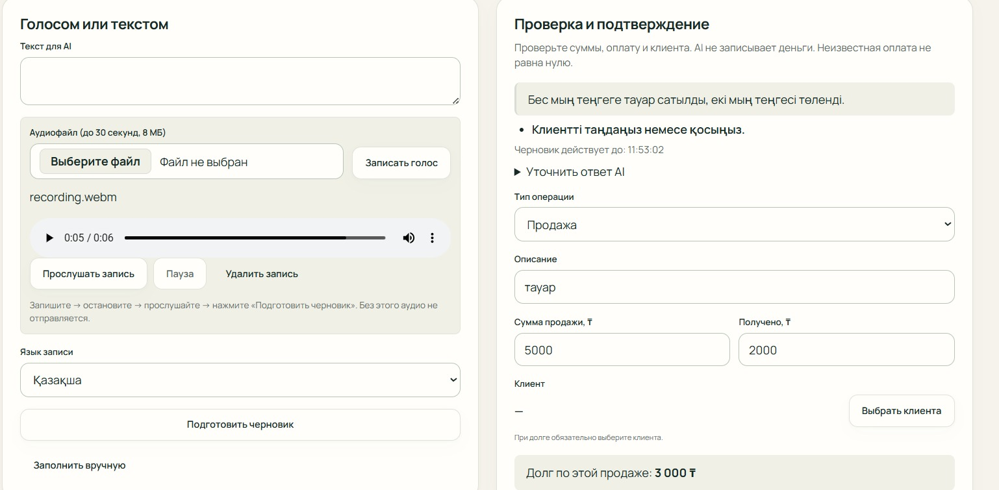

# Физические устройства — evidence от пользователя, 18.10.2026

**Источник: User-reported Test / user-provided screenshots.** Агент просмотрел восемь оригинальных кадров и сверил побайтовые копии. Он не наблюдал физические нажатия, не слышал звук и не выполнял эти голосовые запросы. Это ограниченная приёмка видимых функций, не end-to-end подтверждение сохранённых денежных операций.

## Источники и версии

- Целевой сайт из задания: <https://qadamx-taraz.pages.dev>. На iPhone виден этот hostname; PC-кадры обрезаны до содержимого, адресная строка отсутствует. Точный URL/path PC и origin Android APK по изображениям не устанавливаются.
- Frontend SHA и backend version **конкретных присланных попыток не подтверждены**. Source QA-ветки: `ae6b6c12fd4b90b48566318270804d8a8708d3b0`; он не выдаётся за SHA опубликованного сайта или установленного APK.
- PC, iPhone Safari и Android APK — классификация из прямого задания пользователя. Модели устройств, версии ОС/браузеров неизвестны. Внешний вид iPhone согласуется с мобильным Safari; отдельного подтверждения версии нет.
- APK package, version, source commit и SHA-256 установленной сборки не предоставлены. Нельзя утверждать «проверена APK 0.5.2» только по оформлению кадра.
- Фактическая учебная точка — **«Демо Кайкармет food»**, подтверждена пользователем 18.10.2026; на iPhone видны её название и режим **«Рабочие данные»**. PC/Android выбранная точка обрезана, поэтому для них источник названия — уточнение пользователя. Ранее указанная «Демо Ауыл Береке food» относилась к плану, а не к фактическим попыткам. Для продолжения используется «Демо Кайкармет food»; существующие результаты не удаляются.
- Стартовые показатели «Мне должны», «Продажи за сегодня», «Поступления за сегодня» — **Не зафиксировано**. Присланные кадры показывают отдельные черновики, а не начальные агрегаты. Нулевые значения из synthetic fixtures не относятся к этой точке. Итоговые агрегаты и финансовая сверка также не зафиксированы.
- Имена исходных файлов содержат 11:31; часы iPhone показывают 11:16/11:20, Android — 11:29. Это не интервалы начала/конца действий. Время истечения AI-черновика также не является измерением времени операции.
- [Manifest оригиналов](evidence/voice-20261018/manifest.json): исходное имя, имя копии, размер и SHA-256. Все восемь копий совпадают с файлами из Downloads. Изображения не дорисовывались, не обрезались и не заменялись synthetic screenshots.

## Что видно на PC

| Кадр | Фактическое наблюдение | Статус / предел доказательства |
|---|---|---|
| [PC-1: голос 5000/2000](evidence/voice-20261018/pc-voice-5000-2000.jpeg) | `recording.webm`, аудиоплеер около `0:05 / 0:06`, кнопки прослушивания/паузы/удаления; язык записи «Қазақша». Распознан казахский текст про 5000 ₸ и оплату 2000 ₸. Поля: продажа 5000, получено 2000, остаток 3000. AI просит выбрать/добавить клиента | Подтверждены видимые плеер и черновик. Физический источник файла, слышимость playback, permission и Stop по статичному кадру не доказаны. Клиент не выбран; сохранение не показано |
| [PC-2: ручная форма 3000/2000](evidence/voice-20261018/pc-manual-validation-3000-2000.jpeg) | Продажа 3000, получено 2000, остаток 1000; клиент «—». Видно сообщение о необходимости суммы, оплаты и клиента при долге | Видна валидация незавершённой формы. Это не успешная запись и не само по себе дефект. Отличается от timing-сценария №1 (3000/1000) |
| [PC-3: уточнение 1200](evidence/voice-20261018/pc-clarification-1200.jpeg) | Текст «Продажа 1200, оплатили сразу полностью»; вопрос «Уточните товар или назначение»; тип «Продажа» | Подтверждён запрос уточнения. Нижние поля и сохранение обрезаны; итоговые суммы/операция не проверены |

## Что видно на iPhone Safari

| Кадры | Фактическое наблюдение | Статус / предел доказательства |
|---|---|---|
| [iPhone-1: расшифровка](evidence/voice-20261018/iphone-transcript-50000.jpeg), [iPhone-2: поля](evidence/voice-20261018/iphone-review-50000-30000.jpeg) | Фраза о продаже на 50 тысяч и 20 тысяч в долг. На связанном кадре: продажа 50000, получено 30000, остаток 20000. Виден запрос выбрать/создать клиента; клиент не выбран | Согласованный по смыслу черновик и мобильная форма. Статус сохранения отсутствует. Наличие кнопки «Подтвердить запись» не доказывает успешный POST |
| [iPhone-3: вопрос](evidence/voice-20261018/iphone-clarification-300000.jpeg), [iPhone-4: пустая оплата](evidence/voice-20261018/iphone-unknown-payment-300000.jpeg) | Фраза совмещает продажи 300000 и закупку на миллион. AI задаёт «Сколько оплачено сейчас?» и просит клиента. Сумма продажи 300000, поле получено пустое | На кадре неопределённая оплата сохранена пустой; ноль не подставлен. Учёт закупки и итоговая финансовая запись не подтверждены |

Эти две пары кадров не дают полного журнала запросов и не позволяют надёжно восстановить число платных попыток или исправленных полей.

## Что видно на Android APK

[Android-1: запись и казахский черновик](evidence/voice-20261018/android-apk-kz-1000.jpeg): выбран «Голос», написано «Готово к прослушиванию: 4.9 с», доступны «Прослушать», «Удалить / перезаписать», выбор аудиофайла. В блоке «Распознано» виден казахский текст «Мың теңгеге тауар сатылды, толықтай төленді.», сумма 1000 ₸ и получено 1000 ₸. Есть «Проверить и исправить» и «Отменить черновик».

**4,9 с — длительность аудио, не время ввода, AI или сохранения.** Видимый playback control не доказывает, что звук был прослушан и слышен. Физическая запись и использование APK сообщены пользователем; агент не проверял микрофон лично. Финальный экран проверки/сохранения отсутствует. Точная сборка APK не идентифицирована.

## Неудачи, незавершённые шаги и ограничения

- PC-2: незавершённая форма/валидация без клиента. Сохранение не подтверждено; причину нельзя переименовывать в сетевой сбой или дефект backend.
- PC-3: AI запросил товар/назначение; продолжение отсутствует.
- PC-1 и iPhone-1/2: нужен выбор клиента при долге. Нет evidence успешной серверной записи.
- iPhone-3/4: требуется уточнить оплату; не заменять её нулём для красивого результата.
- Нельзя определить порядок всех пользовательских попыток, число исправлений, все ошибки/повторы и общий AI-расход по восьми кадрам. В этой задаче агент сделал **0 платных AI-запросов и 0 реальных финансовых POST**; это не утверждение о расходе пользователя.
- Не проверены: permission allow/deny на физических устройствах, MIME фактического файла, запись до лимита 30 с, Stop/cancel как действие, звук playback, загрузка файла, физический Android Chrome, package/SHA APK, сохранение, идемпотентность, финансовая сверка.
- Старый локальный runner при чтении результатов находился в `setup`, без попыток и времён. Длительности не восстановлены по часам кадров. Полного парного человеческого замера нет.

## Отделение от автоматизированных тестов

[Automated Playwright Timing](AUTOMATED_MANUAL_ENTRY_TIMING.md) запускает существующий frontend локально с синтетическими Auth/API. Его времена не относятся к человеку, микрофону или production latency. Реальные кадры здесь и synthetic timing имеют разное происхождение; сравнение скорости запрещено.

[Материалы и RU/KZ подписи для Абзала](VOICE_PRESENTATION_HANDOFF.md).
