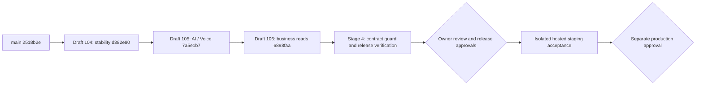

# Stage 4 — release checklist

12.11.2026. Candidate only: no merge, deploy or hosted migration is performed.
The accompanying [audit](QADAM_STAGE4_INTEGRATION_AUDIT.md) contains actual results.

## Dependencies and exact merge order

1. Captain verifies fresh HEADs and prevents a partial stack from automatically
   deploying to production. Read hosting settings first; this checklist does not
   authorize changes to them.
2. Review #104, then merge **with history preserved**, only after approval.
3. Fetch. Retarget #105 to main manually, inspect its new diff and CI, verify
   #104's original commits are ancestors. Approve and merge #105.
4. Repeat for #106 after #105; then for the separate Stage 4 PR after #106.
5. If main changes, compare before proceeding. A failed `pull --ff-only` is a
   stop condition; no force push, automatic rebase or conflict resolution.
6. If repository policy requires squash/rebase, stop and have the captain plan
   the stack adjustment. Do not blindly retarget all descendants after squash.
7. Merging code is not permission to deploy. Release only the final reviewed
   frontend/backend pair; verify deployed SHA and OpenAPI independently.

Never merge descendants into their feature bases as a shortcut. Do not mark
#104–106 Ready or merge them as part of this audit.

## Approvals required

- [ ] Captain/repository owner: stack order, exact candidate SHA, merge method.
- [ ] Backend/ledger owner: read-query semantics, financial/isolation results,
  API header and CORS, no write-rule/schema change.
- [ ] Seller/ledger frontend owners: RU/KZ, read errors, filters, report/export,
  Stage 1 Auth recovery and Stage 2 drafts.
- [ ] Dependency/security owner: Vitest 4 migration and any remaining development
  dependency advisories. Never run untrusted tests with secrets or public test UI.
- [ ] Hosting owner: Render logs/settings, exact staging origin and artifact pair,
  deployment/rollback authorization. No billing change implied.
- [ ] Supabase/database owner: designated staging project, Auth settings, schema
  revision and backup. No production credentials in test env.
- [ ] Test owner: synthetic account/business and permission for staged financial
  records; separate provider budget/consent for any live AI.
- [ ] Real device operator: physical Android/iPhone/browser/microphone acceptance.
- [ ] Separate explicit production approval after every mandatory gate passes.

## Database plan

Stage 1–4 introduce **no database migration** relative to audited main.
The repository has one Alembic head: `0008_canonical_markets`.
Migration/model files and ledger write functions match main; Stage 3 extends
only history reads and adds read projections. Other diploma branches' 0009/0010
are outside this stack and must not be imported implicitly.

Before an authorized staging release, the DB owner privately checks
`uv run alembic current` and compares with `uv run alembic heads`.
If staging is already at 0008, no migration is required. Otherwise stop, inspect
the missing revisions, take/verify a backup, and obtain a separate migration
approval. An empty isolated local `*_test` DB can use the existing pytest fixture
to upgrade/check/downgrade; it must never point to staging/production.

No seed, TRUNCATE, pytest fixture, DROP, downgrade or reset on a shared database.
Do not infer hosted revision/connectivity from `/health`.

## Rollout compatibility gate

- [ ] Publish the approved backend before the new frontend, within the approved
  release window. Old frontend reads/writes remain compatible with API 0.8.0.
- [ ] Verify OpenAPI version 0.8.0, the `report` endpoint and new operation filters.
- [ ] Verify `X-Qadam-API-Version: 0.8.0` is readable from the exact staging origin
  through `Access-Control-Expose-Headers`.
- [ ] New filtered lists and reports reject missing/different headers. Do not
  remove this guard or substitute Demo results to make acceptance pass.
- [ ] Confirm JWT issuer/audience/JWKS and Membership checks with two accounts.
- [ ] Check `Retry-After` exposure, bounded Auth/read timeouts and explicit Retry.
- [ ] Confirm Stage 2's private fact-bindings-v1 prompt/validator are deployed
  together. Its offline tests do not prove live model or speech quality.

## Staging acceptance (not yet executed)

Use a separate approved synthetic business; record URL, frontend/backend SHA,
OpenAPI, schema revision, timezone and starting UI/API balances.

- [ ] Cold first load, explicit retry after service wake, login/reload/logout,
  expired token, no membership, new account, account A → B → A late response.
- [ ] Backend down, DB unavailable and Auth unavailable are distinguishable;
  no infinite loading or automatic money retry.
- [ ] Create customer; sale 3000/1000; repayment 500; reverse that repayment;
  sale 1200/1200. UI/API/SQL: **4200/2200/2000 KZT**, four journal rows.
- [ ] Same-key double submit returns the same operation. Conflicting body fails.
  Concurrent repayments cannot exceed debt; failed transaction leaves no partial row.
- [ ] Cross-account/business/customer/cursor reads and writes denied; point switch
  and reload never show another account's results.
- [ ] Customer profile/purchase/repayment history, date/customer/amount/type/status
  filters, calendar age and RU/KZ reminders. No invented overdue date or delivery.
- [ ] Complete period report, opening/closing/current debt, reversals across dates,
  empty/error/retry, CSV injection protection and physical print preview.
- [ ] AI/Voice editable draft, missing fields, 429 Retry-After, invalid JSON,
  no operation before explicit confirmation; manual entry remains available.
- [ ] 360/390/768/1440 px, RU/KZ; physical Safari/Chrome and mic allow/deny/stop/cancel.
- [ ] Public storefront/inquiry and existing Analytics work with the deployed pair.
- [ ] No console errors/private data in logs; observe request IDs and service logs.

## Rollback plan

Record known-good web/API artifact SHAs and hosting rollback procedure before
release; do not rely on Free hosting retaining unlimited historical deploys.
If the new client/backend are incompatible, stop new release activity, retain
failed request IDs, and use the approved prior frontend artifact first, then the
approved prior backend if needed. Do not replay pending POSTs with new keys.

No new schema or write representation exists in Stage 1–4, so application rollback
does not require reversing data or downgrading the database. Keep financial rows,
idempotency records, users and memberships. If actual hosted schema diverges,
stop and involve the DB owner rather than executing this assumption blindly.

## Release decision

Passing local tests allows code review, not automatic production GO.
Hosted backend is currently API 0.7.2; the new report is absent. Authenticated
hosted acceptance, migration revision, owner logs and physical device checks
remain mandatory. CI Preview build alone cannot replace these gates.
