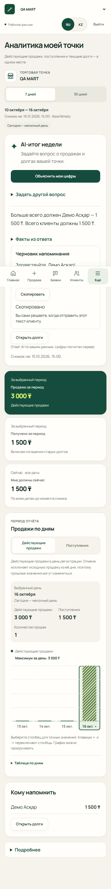
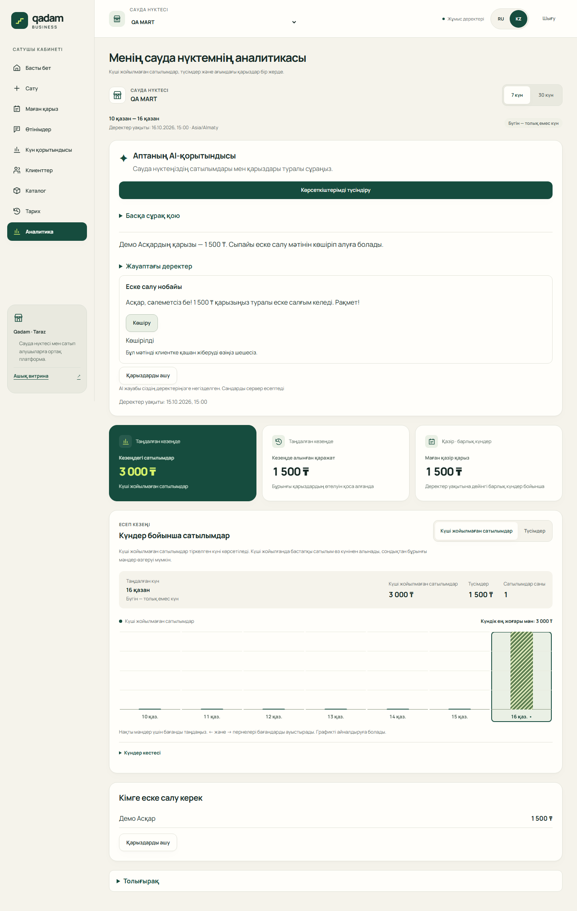

# «Спросите Qadam» и новая аналитика

2026-10-18, ветка `feature/ai-assistant-ui`, база main `3061623`.
Chromium, локальный Vite и перехваченные синтетические Auth/API. Это демонстрация
интерфейса по контракту, а не вызов живой модели. Суммы учебные: продажа 3 000 ₸,
поступления 1 500 ₸, остаток 1 500 ₸. Флаг помощника включён только в тестовом сервере.

| Язык | Телефон 390 px | Десктоп 1440 px |
|---|---|---|
| RU | [Снимок](ru-390.png) | [Снимок](ru-1440.png) |
| KZ | [Снимок](kk-390.png) | [Снимок](kk-1440.png) |





Сценарий снимка: открыть аналитику → «Объяснить мои цифры» → получить синтетический
ответ → скопировать напоминание. Список «Кому напомнить» использует факты того же ответа.
На снимках `Подробнее` и подробные факты закрыты. Проверка дополнительно раскрывает
вопрос и почасовой график с клавиатуры, меняет период и проверяет ширину 360 px.

Повторить из `apps/web`:

```text
npm run test:e2e -- --config e2e/assistant.playwright.config.ts
```

Снимки создаёт `e2e/assistant.spec.ts`; секретов, внешних запросов и реальных долгов нет.
