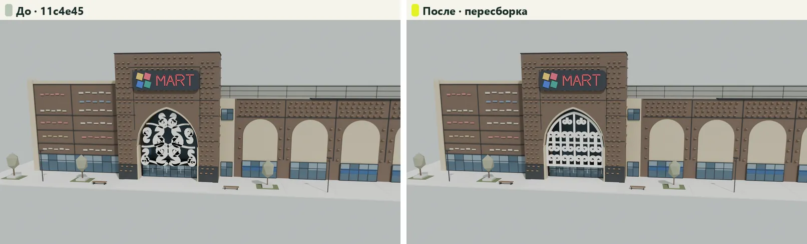
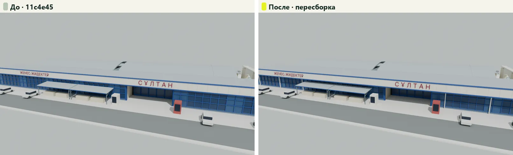
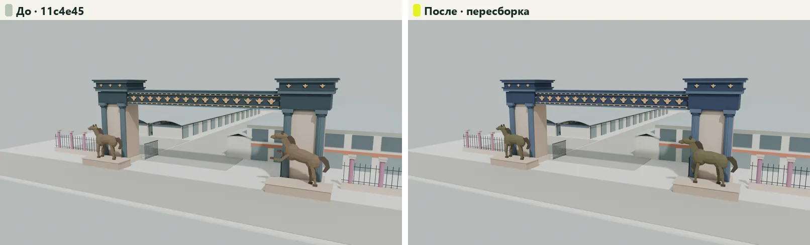

# Модели площадок — до и после пересборки

**До:** опубликованные ассеты автора моделей `11c4e45` (они же на `feature/unified-visual-3d-d` @ `3765ddb`). **После:** ветка `feature/unified-visual-3d-models`, пересборка 16.10.2026 в Blender 4.5.14 LTS штатным `tools/assets/build_venues.py`.

Кадры «Вход» и «Общий вид» — Cycles-рендеры обоих GLB с одинаковыми камерами и светом (направление общего вида — стартовая камера manifest до правки). «Превью» — WebP из manifest (`poster_url`). «Приложение» — сцена в настоящем `apps/web` с живым публичным API, headless Chrome с программным WebGL; это не снимки физического телефона. Отчёт и проверки — [VISUAL_MODELS](../../../VISUAL_MODELS.md).

| Площадка | Вход | Общий вид | Превью | Приложение 1440 | Приложение 390 |
|---|---|---|---|---|---|
| MART | [сравнение](mart-entrance.webp) | [сравнение](mart-overview.webp) | [сравнение](mart-poster.webp) | [сравнение](mart-app-1440.webp) | [сравнение](mart-app-390.webp) |
| Кайкармет | [сравнение](kaikarmet-entrance.webp) | [сравнение](kaikarmet-overview.webp) | [сравнение](kaikarmet-poster.webp) | [сравнение](kaikarmet-app-1440.webp) | [сравнение](kaikarmet-app-390.webp) |
| Ауыл Береке | [сравнение](auyl-bereke-entrance.webp) | [сравнение](auyl-bereke-overview.webp) | [сравнение](auyl-bereke-poster.webp) | [сравнение](auyl-bereke-app-1440.webp) | [сравнение](auyl-bereke-app-390.webp) |

