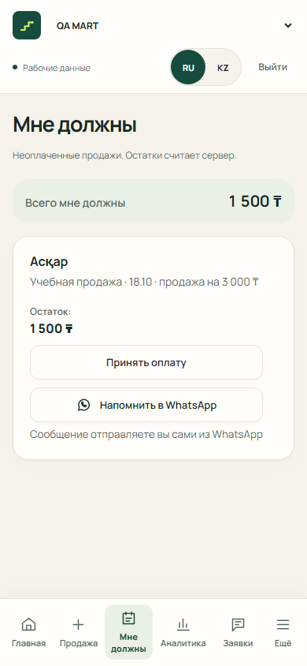
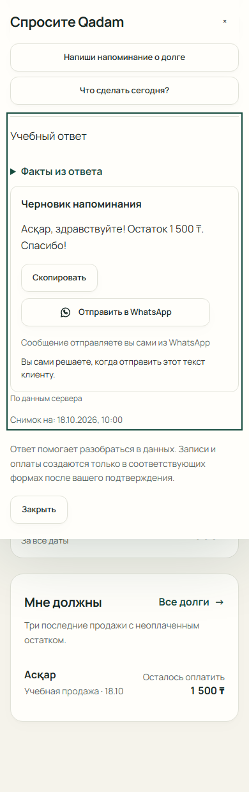

# Напоминания в WhatsApp — 390 px, RU

Снимки локальной сборки `feature/whatsapp-reminder`: Chromium, 390 × 844.
Auth, клиент, телефон, продажа и ответ помощника — синтетические фикстуры.
WhatsApp не открывался, сообщения не отправлялись. Это не физический телефон,
не живой AI и не приёмка production.

На долгах текст берёт остаток конкретной продажи из ответа API: 150 000 тиын.
В помощнике ссылка передаёт исходный текст карточки напоминания без изменений.
В обоих случаях окончательный выбор и отправка остаются за продавцом в WhatsApp.





Воспроизведение из `apps/web`:

```powershell
npx playwright test -c e2e/whatsapp-reminder.playwright.config.ts --retries=0
```

Набор дополнительно проверяет RU/KZ при 360/390/1440 px, размер ссылки не менее
44 px, отсутствие горизонтального скролла, точный адрес и режим Demo без API.
